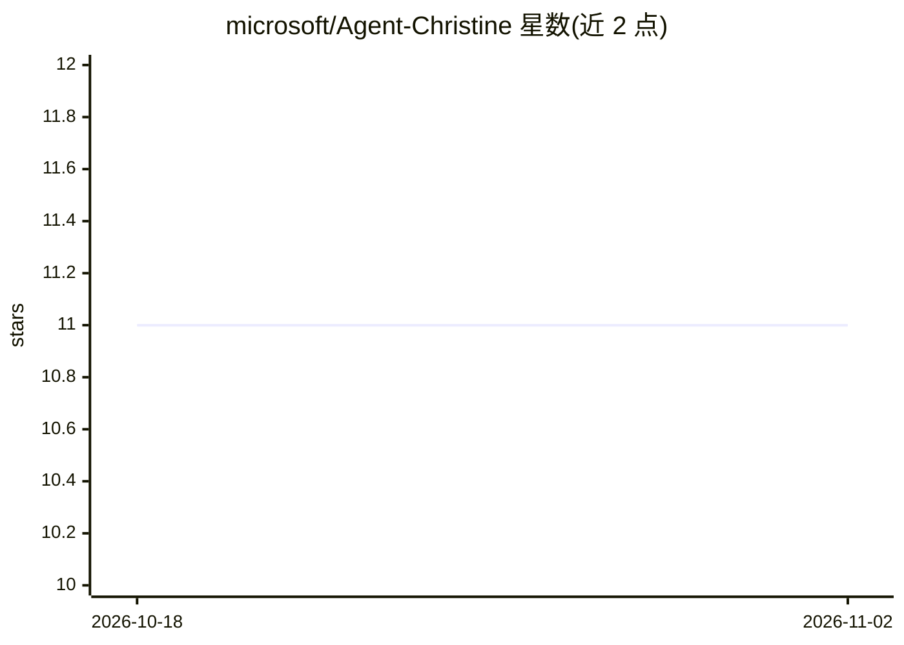

# microsoft/Agent-Christine

⭐ 11 · MIT · 推送 2026-03-10 · [GitHub](https://github.com/microsoft/Agent-Christine) · 组织维护

**面向 Microsoft 合作伙伴的 Marketplace 助手虚拟 agent**

Agent Christine 是一个用 Copilot Studio 构建的虚拟代理，目标用户是通过 Microsoft Marketplace 销售的合作伙伴，帮助其自助完成 Partner Center 导航、入驻、联合销售、交易与收入对账等操作，减少对持续人工支持的依赖。使用方式为下载 agent .zip 并导入合作伙伴自己的 Copilot Studio 环境，数据留在本地以保证隐私；合作伙伴可添加自有知识源（SharePoint、docx、xlsx、SOP）获得个性化回答。运行前还需从 Partner Center 下载 Earnings/Revenue 报表并填写 Marketplace Drive 模板。以 MIT 许可开源，但声明不由 Microsoft 提供支持。

## 筛选速览

| 维度 | 判定 | 备注 |
|---|---|---|
| AI 角色 | `ai-native` | 本体是模型或模型工具 |
| 许可风险 | `permissive` | MIT |
| 部署形态 | `desktop` | 安装包/桌面程序 |
| 模型依赖 | — | README 未给出锁定关系 |
| 硬件要求 | — | 无带数字的原话,不猜 |
| 安装摩擦 | `low` | 无编译、无系统依赖或容器化 |
| 成熟度 | — | 结构信号不足 |

## 能力要点

- 用 Copilot Studio 构建，导入合作伙伴自有环境运行
- 支持接入自有知识源（SharePoint/docx/xlsx/SOP）
- 覆盖入驻、联合销售、交易、收入对账场景
- 内置 Trigger 可从 Partner Center 下载 Earnings 报表

## 适用场景

- 合作伙伴自助完成 Marketplace 入驻与联合销售操作
- 获取策展的交付物、文档与最佳实践资料
- 接入自有文档获得个性化的 Marketplace 指导

## 场景标签

`聊天机器人` `文档问答` · 领域:对话与助手

## 证据(README 行号)

> L6: The goal of Agent Christine is to help partners selling through the Microsoft Marketplace become self-sufficient in 
> L12: Agent Christine is built using Copilot Studio and is imported to the partner's environment for complete privacy and

## 星数曲线

2026-10-18 11 → 2026-11-02 11（+0）

---
*卡片 v1 · prompt 1.4 · 生成 2026-11-02 · 置信度 high · 依据 README sha `9dbd1d06e1d6` · [字段定义](../../DATASET.md)*
