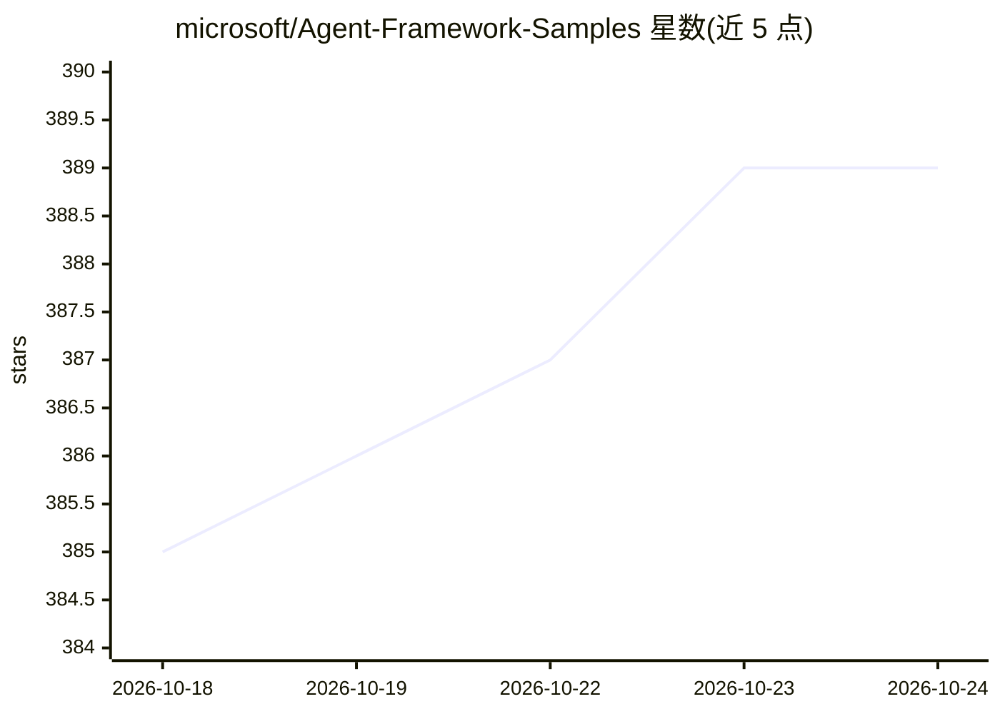

# microsoft/Agent-Framework-Samples

⭐ 389 · Jupyter Notebook · MIT · 推送 2026-06-28 · [GitHub](https://github.com/microsoft/Agent-Framework-Samples) · [官网](https://github.com/microsoft/agent-framework) · 组织维护

**微软 Agent Framework 官方示例教程库：Python/.NET 双栈学建智能体**

microsoft/agent-framework 的配套实操示例仓库，含 10 个章节（00-09）覆盖入门教程、首个 Agent 构建、Provider 探索、工具集成、MCP 与 Agent 间通信、RAG、多智能体编排、工作流、评测追踪与真实案例，每章提供 Python 与 .NET 双实现。示例主要基于 GitHub Models 与 Microsoft Foundry，需配置 token/endpoint，部分示例需 Azure CLI 认证。支持 pip/dotnet 安装发布版或从源码构建，Python 需 3.10+，.NET 需 9.0+。

## 筛选速览

| 维度 | 判定 | 备注 |
|---|---|---|
| AI 角色 | `ai-knowledge` | 知识聚合/清单类 |
| 许可风险 | `permissive` | MIT |
| 部署形态 | `library` | 以包/库形式分发 |
| 模型依赖 | locked-api |  |
| 硬件要求 | — | 无带数字的原话,不猜 |
| 安装摩擦 | `medium` | 含编译或系统依赖之一 |
| 成熟度 | — | 结构信号不足 |

## 能力要点

- 10 个章节覆盖入门到多智能体工作流与评测追踪，Python/.NET 双实现
- 示例主要基于 GitHub Models 与 Microsoft Foundry，演示 Azure OpenAI 等多 Provider
- 演示 MCP 集成、RAG 文件搜索、流式响应与 DevUI 可视化调试
- 提供发布版 pip/dotnet 安装与源码构建两种路径

## 适用场景

- 跟着教程从零学习 Microsoft Agent Framework 构建 Agent
- 查找工具集成、RAG、多智能体编排的参考代码
- 对比 Python 与 .NET 两种实现方式

## 场景标签

`Agent 框架` `教程课程` · 领域:Agent 开发

## 证据(README 行号)

> L3: A comprehensive hands-on guide to building intelligent agents using the Microsoft Agent Framework. This repository c
> L20: |Directory|Description|.NET Code Samples|Python Code Samples|
> L38: > 1. The examples in this repository are primarily based on **GitHub Models** and **Microsoft Foundry**. You can ac

## 星数曲线

2026-10-18 385 → 2026-10-24 389（+4）

---
*卡片 v1 · prompt 1.4 · 生成 2026-10-21 · 置信度 high · 依据 README sha `b7f575ea4da7` · [字段定义](../../DATASET.md)*
