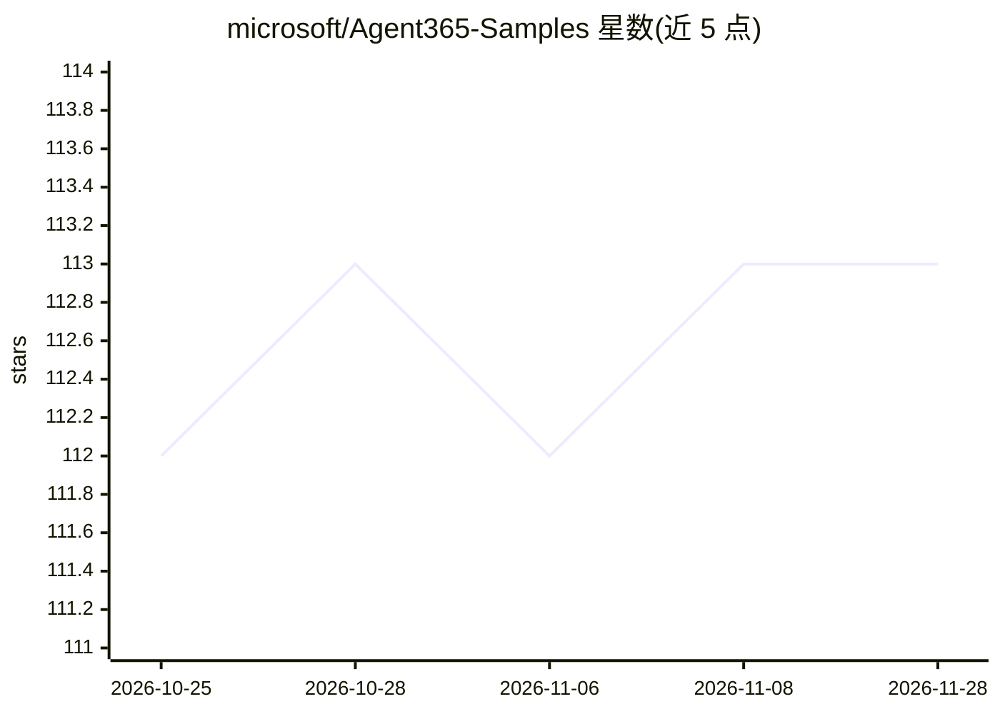

# microsoft/Agent365-Samples

⭐ 113 · TypeScript · MIT · 推送 2026-11-25 · [GitHub](https://github.com/microsoft/Agent365-Samples) · 组织维护

**微软 Agent 365 SDK 的示例代理与提示词集**

微软官方仓库，包含用于 Microsoft Agent 365 SDK 的示例代理与提示词。SDK 在 Microsoft 365 Agents SDK 基础上扩展可观测性、通知、运行时工具与开发工具，帮助开发者构建面向 M365、Teams、Copilot Studio 和 Webchat 平台的生产级代理。示例覆盖 C#/.NET、Python、Node.js/TypeScript、Salesforce/Apex 四种语言；另含供 Cursor IDE 等 AI 开发工具使用的提示词。README 主要说明可观测性 S2S 导出的令牌要求与 SDK 版本查看方式，本仓库未提供独立安装命令。

## 筛选速览

| 维度 | 判定 | 备注 |
|---|---|---|
| AI 角色 | `ai-ecosystem` | LLM/agent 周边工具 |
| 许可风险 | `permissive` | MIT |
| 部署形态 | `None` |  |
| 模型依赖 | — | README 未给出锁定关系 |
| 硬件要求 | — | 无带数字的原话,不猜 |
| 安装摩擦 | `low` | 无编译、无系统依赖或容器化 |
| 成熟度 | — | 结构信号不足 |

## 能力要点

- 覆盖 C#/.NET、Python、Node.js/TypeScript、Salesforce/Apex 的端到端示例代理
- 可观测性 S2S OTLP 导出的令牌契约与验证说明
- 提供用于 Cursor IDE 等 AI 开发工具的提示词
- 通过 E2E 工作流日志展示各示例解析的 SDK 版本

## 适用场景

- 参考示例在 Microsoft 365 平台上构建企业级代理
- 为代理配置符合要求的可观测性遥测导出
- 用提示词加速基于 SDK 的代理开发

## 场景标签

`Agent 框架` · 领域:Agent 开发

## 证据(README 行号)

> L3: This repository contains sample agents and prompts for building with the Microsoft Agent 365 SDK. The Microsoft Agen
> L42: - **Sample Agents**: Complete, end-to-end examples in C#/.NET, Python, Node.js/TypeScript, and Salesforce/Apex demo

## 星数曲线

2026-10-25 112 → 2026-11-28 113（+1）

---
*卡片 v1 · prompt 1.4 · 生成 2026-11-28 · 置信度 high · 依据 README sha `8ef47a541c90` · [字段定义](../../DATASET.md)*
