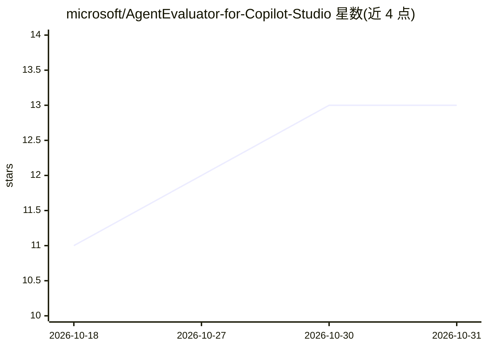

# microsoft/AgentEvaluator-for-Copilot-Studio

⭐ 13 · Jupyter Notebook · MIT · 推送 2026-10-27 · [GitHub](https://github.com/microsoft/AgentEvaluator-for-Copilot-Studio) · 组织维护

**分析 Copilot Studio 代理性能与成本的 Power BI 模板**

由 Microsoft Business Value Advisory 团队维护的 Power BI 模板（.pbit），读取 Dataverse 中记录的 Copilot Studio 代理会话转录，分析质量、解决率、containment、话题、错误、用户反馈与消息积分消耗，共九个报告页。支持三种数据源：本地示例 CSV、Dataverse 实时转录、Fabric Delta 表（消息积分页仅 Fabric 路径可用）。模板声明为实验性，不经 Microsoft 支持渠道提供支持；区分设计内的转人工与真实错误，避免 containment 高估。

## 筛选速览

| 维度 | 判定 | 备注 |
|---|---|---|
| AI 角色 | `ai-ecosystem` | LLM/agent 周边工具 |
| 许可风险 | `permissive` | MIT |
| 部署形态 | `None` |  |
| 模型依赖 | — | README 未给出锁定关系 |
| 硬件要求 | — | 无带数字的原话,不猜 |
| 安装摩擦 | `low` | 无编译、无系统依赖或容器化 |
| 成熟度 | `idea` | |

## 能力要点

- 一个 .pbit 模板覆盖本地 CSV / Dataverse / Fabric 三种数据源
- 九页报告：性能、话题、转录浏览器、积分消耗、CSAT 等
- 区分设计内升级与错误/give-up，避免 containment 高估
- 内置示例数据，本地 CSV 路径约两分钟渲染完成

## 适用场景

- 我要评估 Copilot Studio 代理是否解决用户问题、在哪里失败
- 查看代理的消息积分消耗与花费去向
- 浏览真实会话转录并核对用户反馈

## 场景标签

`LLM 可观测性` · 领域:评测与运维

## 证据(README 行号)

> L5: ### **for Copilot Studio** — one Power BI template for **deep agent performance & evaluation**: quality, containment
> L10: user feedback · Copilot Studio message-credit consumption** — purpose-built to analyse how your

## 星数曲线

2026-10-18 11 → 2026-10-31 13（+2）

---
*卡片 v1 · prompt 1.4 · 生成 2026-10-31 · 置信度 high · 依据 README sha `10a70840c495` · [字段定义](../../DATASET.md)*
