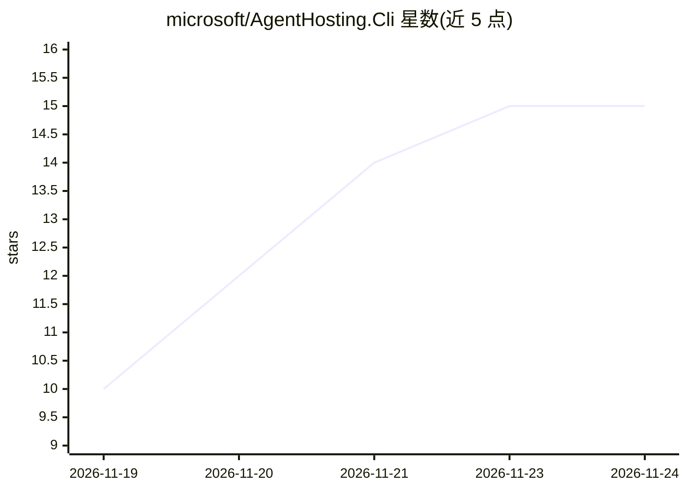

# microsoft/AgentHosting.Cli

⭐ 15 · C# · MIT · 推送 2026-11-22 · [GitHub](https://github.com/microsoft/AgentHosting.Cli) · 组织维护

**Microsoft 官方 CLI：以代码方式开发和管理 Copilot Studio 代理**

Microsoft.Agents.Hosting.CLI（msagent）将本地开发工作流与 Microsoft Copilot Studio 连接：把代理与工作流定义为代码，支持创建、更新代理，认证与环境管理，测试评估与部署，从而在 Copilot Studio 之上应用 SDLC/ALM 实践。当前处于 Public Preview，功能可能变更；本地测试会调用真实 Copilot Studio 运行时并可能消耗 Copilot Credits；内置遥测可通过命令关闭。以 .NET 工具分发，需 .NET 10 SDK（含两个运行时）。

## 筛选速览

| 维度 | 判定 | 备注 |
|---|---|---|
| AI 角色 | `ai-ecosystem` | LLM/agent 周边工具 |
| 许可风险 | `permissive` | MIT |
| 部署形态 | `None` |  |
| 模型依赖 | — | README 未给出锁定关系 |
| 硬件要求 | — | 无带数字的原话,不猜 |
| 安装摩擦 | `medium` | 含编译或系统依赖之一 |
| 成熟度 | `idea` | |

## 能力要点

- 以代码定义代理与工作流，并与 Copilot Studio UI 协同
- 多环境认证配置管理（profile 创建/选择/清除）
- 代理创建、部署、评估、发布的命令行流程
- 内置遥测可查看/禁用/启用

## 适用场景

- 把 Copilot Studio 代理纳入版本控制与 SDLC 流程
- 团队以代码方式协作开发代理并与 UI 用户配合
- 本地命令行创建、测试并发布代理

## 场景标签

`Agent 框架` · 领域:Agent 开发

## 证据(README 行号)

> L10: The Microsoft.Agents.Hosting.CLI (`msagent`) connects local development workflows with Microsoft Copilot Studio. It
> L21: - .NET 10 SDK to run `dotnet tool install` and `dotnet tool update`. The SDK includes the .NET 10 and ASP.NET Core 

## 星数曲线

2026-11-19 10 → 2026-11-24 15（+5）

---
*卡片 v1 · prompt 1.4 · 生成 2026-11-19 · 置信度 high · 依据 README sha `10f6c1cefbf2` · [字段定义](../../DATASET.md)*
