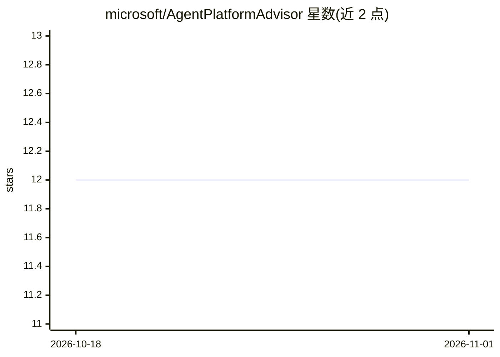

# microsoft/AgentPlatformAdvisor

⭐ 12 · JavaScript · MIT · 推送 2026-10-30 · [GitHub](https://github.com/microsoft/AgentPlatformAdvisor) · 组织维护

**微软 Agent 平台选型向导：静态网页帮你选 Copilot/Studio/Foundry**

微软维护的纯静态单页 Web 应用，帮助用户在微软 agent 生态中做选型：入门向导按工作方式路由到 Microsoft 365 Copilot、Copilot Cowork 或 Microsoft Scout；定制 agent 评估通过 5 题打分（每平台最高 15 分）推荐 Agent Builder、Copilot Studio 或 Microsoft Foundry，含硬性规则淘汰、运行时归属附加题与并列解释。所有问题、评分与推荐内容来自 apa.yaml 数据文件，无后端、无构建步骤；支持深色模式、sessionStorage 持久化与编码完整结果的分享链接。提供 Playwright 端到端测试。

## 筛选速览

| 维度 | 判定 | 备注 |
|---|---|---|
| AI 角色 | `ai-knowledge` | 知识聚合/清单类 |
| 许可风险 | `permissive` | MIT |
| 部署形态 | `library` | 以包/库形式分发 |
| 模型依赖 | — | README 未给出锁定关系 |
| 硬件要求 | — | 无带数字的原话,不猜 |
| 安装摩擦 | `low` | 无编译、无系统依赖或容器化 |
| 成熟度 | — | 结构信号不足 |

## 能力要点

- 两条路径：终端用户入门路由向导 + 定制 agent 打分评估（5 题/最高 15 分）
- apa.yaml 单一数据源驱动问题、评分与推荐，纯静态无后端
- 分享链接编码路径、答案与推荐，apa.yaml 更新后可显示时效变更横幅
- Playwright 覆盖 16 个 spec 文件及黄金路径脚本

## 适用场景

- 我不知道该用 Copilot Studio 还是 Foundry，做套题得到推荐
- 找到完成某类工作的正确微软 agent 入口（Copilot/Cowork/Scout）
- 把选型结果以链接形式分享给同事

## 场景标签

 · 领域:AI 平台选型/开发者指南

## 证据(README 行号)

> L9: The Agent Platform Advisor is a static single-page web app that helps people navigate the Microsoft agent landscape.
> L12: 2. **Build agents** — answer a scored assessment that recommends **Agent Builder**, **Copilot Studio**, or **Micros
> L62: ├── apa.yaml                # Source of truth for questions, scores, routing, recommendations, and content

## 星数曲线

2026-10-18 12 → 2026-11-01 12（+0）

---
*卡片 v1 · prompt 1.4 · 生成 2026-11-01 · 置信度 mid · 依据 README sha `f687e91dc61d` · [字段定义](../../DATASET.md)*
