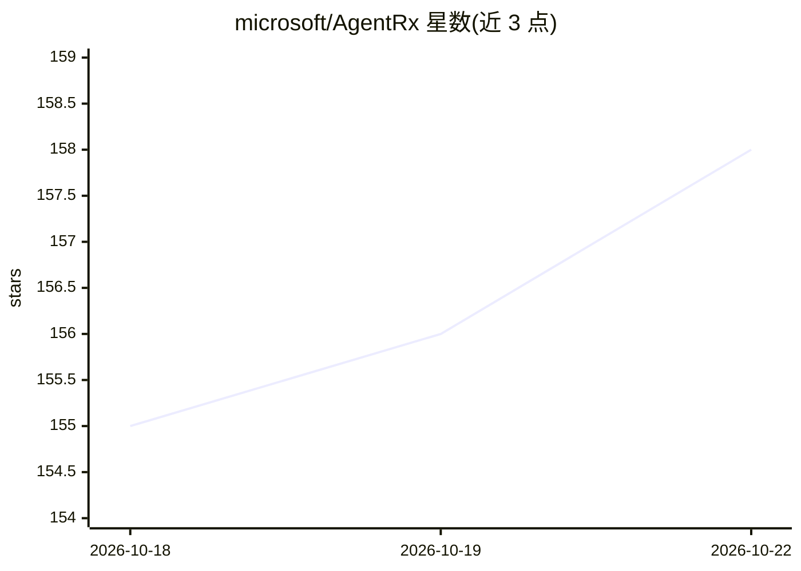

# microsoft/AgentRx

⭐ 158 · Python · MIT · 推送 2026-09-14 · [GitHub](https://github.com/microsoft/AgentRx) · 组织维护

**AI agent 失败诊断框架：从执行轨迹定位关键失败步骤**

微软研究院的自动化、领域无关的 agent 诊断框架：读取失败轨迹，先归一化为 Trajectory IR，再合成静态/动态不变量约束，逐步评估生成可审计的违规验证日志，最终由 LLM-as-a-Judge 定位关键失败步骤并归类到 10 类失败分类法。支持 Tau-bench、Magentic-One、Flash 三类领域及自动检测（未知格式走 LLM 回退）。各阶段可分步运行，各模块也可独立运行。LLM 调用默认走 Azure OpenAI 端点，使用 Azure AD token 认证。

## 筛选速览

| 维度 | 判定 | 备注 |
|---|---|---|
| AI 角色 | `ai-ecosystem` | LLM/agent 周边工具 |
| 许可风险 | `permissive` | MIT |
| 部署形态 | `library` | 以包/库形式分发 |
| 模型依赖 | locked-api |  |
| 硬件要求 | — | 无带数字的原话,不猜 |
| 安装摩擦 | `low` | 无编译、无系统依赖或容器化 |
| 成熟度 | — | 结构信号不足 |

## 能力要点

- 轨迹→IR→不变量→检查器→Judge 的六阶段诊断流水线
- 10 类失败分类法与可审计的违规验证日志
- 支持 tau/magentic/flash 三领域及格式自动检测（LLM 回退）
- 各模块（不变量生成/Checker/Judge）可独立运行

## 适用场景

- 排查多步骤 agent 执行失败的关键步骤
- 对 agent 轨迹做根因分类与失败频率统计
- 研究者在 agent 评测中做失败归因分析

## 场景标签

 · 领域:AI agent 评测/诊断

## 证据(README 行号)

> L7: AI agents often fail in ways that are difficult to localize — executions are probabilistic, long-horizon, multi-agen
> L50: |5|**Judge** — LLM classifies root-cause failure (10-category taxonomy)|`judge_output/`|

## 星数曲线

2026-10-18 155 → 2026-10-22 158（+3）

---
*卡片 v1 · prompt 1.4 · 生成 2026-10-22 · 置信度 mid · 依据 README sha `41895c508f49` · [字段定义](../../DATASET.md)*
