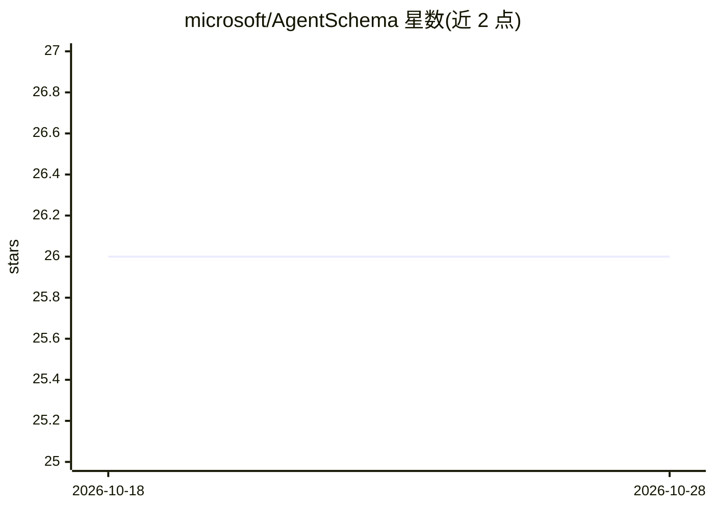

# microsoft/AgentSchema

⭐ 26 · TypeScript · MIT · 推送 2026-07-10 · [GitHub](https://github.com/microsoft/AgentSchema) · 组织维护

**微软的声明式 Agent 规范：用 YAML 定义 agent**

由 Microsoft Copilot Studio 与 Foundry 协作维护的客户端侧规范，以代码优先的 YAML 格式定义 agent，目标是易读、易集成到现有仓库，并作为 MCS 与 Foundry 等平台间的交换格式，构建统一的 agentic 原语对象模型。仓库含 agentschema-emitter（npm，生成文档、schema 与 C#/Python/Go 等运行时代码）与多语言 runtime；本地开发需 Node.js、Python(uv)、.NET SDK、Go 等工具链。

## 筛选速览

| 维度 | 判定 | 备注 |
|---|---|---|
| AI 角色 | `ai-ecosystem` | LLM/agent 周边工具 |
| 许可风险 | `permissive` | MIT |
| 部署形态 | `library` | 以包/库形式分发 |
| 模型依赖 | — | README 未给出锁定关系 |
| 硬件要求 | — | 无带数字的原话,不猜 |
| 安装摩擦 | `medium` | 含编译或系统依赖之一 |
| 成熟度 | — | 结构信号不足 |

## 能力要点

- YAML 代码优先的 agent 声明式规范
- MCS 与 Foundry 平台间的交换格式
- emitter 自动生成文档、schema 与多语言运行时代码
- 提供 C#/Python/Go 多语言 runtime

## 适用场景

- 用 YAML 在现有仓库中声明 agent 结构
- 在 Microsoft Copilot Studio 与 Foundry 之间交换 agent 定义
- 基于多语言 runtime 集成 AgentSchema 运行时

## 场景标签

`Agent 框架` · 领域:Agent 开发

## 证据(README 行号)

> L3: AgentSchema is a client facing spec designed to make creating agents easier in a code first YAML file format. It has
> L7: 3. Serve as an exchange format between MCS and Foundry (and hopefully more platforms in the future).
> L10: This spec is a collaboration between Microsoft Copilot Studio and Microsoft Foundry.

## 星数曲线

2026-10-18 26 → 2026-10-28 26（+0）

---
*卡片 v1 · prompt 1.4 · 生成 2026-10-26 · 置信度 high · 依据 README sha `42a0b3a8320d` · [字段定义](../../DATASET.md)*
