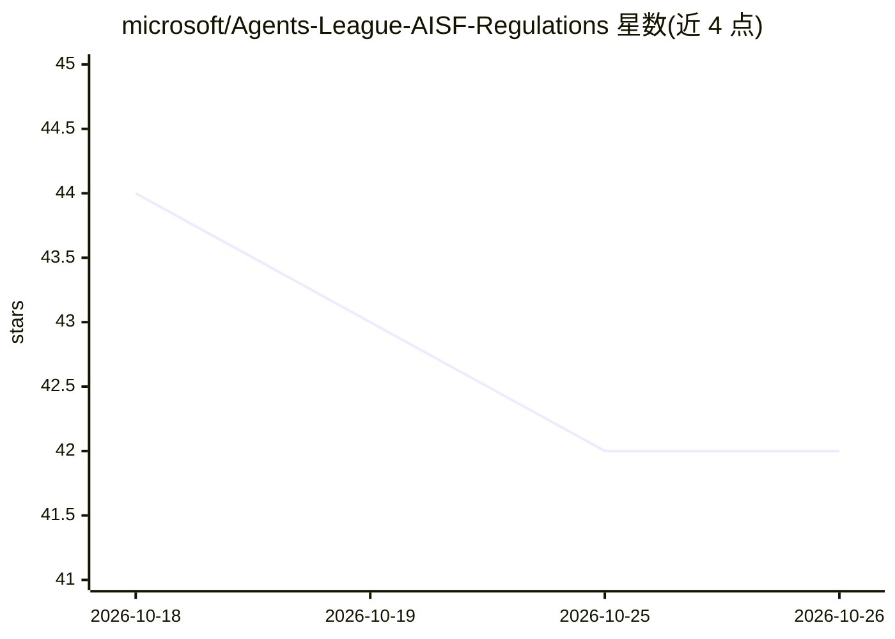

# microsoft/Agents-League-AISF-Regulations

⭐ 42 · MIT · 推送 2026-05-18 · [GitHub](https://github.com/microsoft/Agents-League-AISF-Regulations) · 组织维护

**微软 Agents League 2026 竞赛规则与文档仓库**

存放 Agents League @AISF 2026 开发者竞赛的规则、条例、免责声明与行为准则等文档。该竞赛于 2026 年 6 月 4-14 日举行，设 Creative Apps、Reasoning Agents、Enterprise Agents 三个赛道，参赛项目须集成至少一个 Microsoft IQ 智能层（Foundry IQ、Work IQ 或 Fabric IQ）。仓库本身不提供代码或安装方式，内容为报名指引、评审标准与相关政策链接。

## 筛选速览

| 维度 | 判定 | 备注 |
|---|---|---|
| AI 角色 | `ai-knowledge` | 知识聚合/清单类 |
| 许可风险 | `permissive` | MIT |
| 部署形态 | `None` |  |
| 模型依赖 | — | README 未给出锁定关系 |
| 硬件要求 | — | 无带数字的原话,不猜 |
| 安装摩擦 | `low` | 无编译、无系统依赖或容器化 |
| 成熟度 | — | 结构信号不足 |

## 能力要点

- 竞赛规则、免责声明、行为准则与安全政策文档
- 三个赛道分别对应 GitHub Copilot、Microsoft Foundry、Microsoft 365 Copilot
- 要求参赛项目集成 Foundry IQ / Work IQ / Fabric IQ 之一
- 评审标准含 6 项权重（准确性 20%、推理 20%、可靠性 20% 等）

## 适用场景

- 参赛者查阅竞赛规则与提交要求
- 了解三大赛道与 Microsoft IQ 集成要求
- 查阅评审标准与社区支持渠道

## 场景标签

 · 领域:开发者活动/文档

## 证据(README 行号)

> L1: # Agents League Contest
> L5: Build innovative AI agents for Creative Apps, Reasoning Agents or Enterprise Agents categories. Compete for recognit
> L126: Rules, regulations, disclaimers and similar documentation for Agents League @AISF 2026

## 星数曲线

2026-10-18 44 → 2026-10-26 42（-2）

---
*卡片 v1 · prompt 1.4 · 生成 2026-10-25 · 置信度 high · 依据 README sha `c31686662ae4` · [字段定义](../../DATASET.md)*
