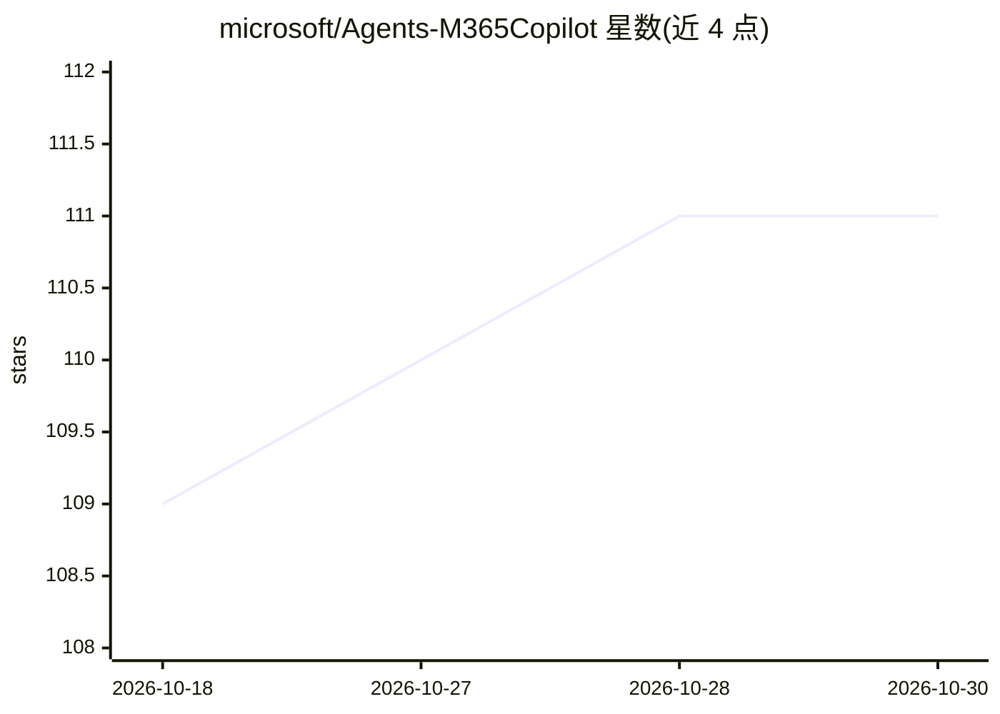

# microsoft/Agents-M365Copilot

⭐ 111 · C# · MIT · 推送 2026-10-26 · [GitHub](https://github.com/microsoft/Agents-M365Copilot) · 组织维护

**微软官方的 Microsoft 365 Copilot API 客户端库，供开发者构建 AI 应用**

由 Microsoft 维护的客户端库，用于访问 Microsoft 365 Copilot APIs。包含两类库：服务库提供模型与请求构建器，以强类型方式调用 Copilot API；核心库提供重试处理、安全重定向、透明认证、负载压缩，并简化分页与批量请求等常规任务。支持 C#、Python、TypeScript 三种语言，作为 Microsoft 365 Agents SDK 的模块分发，可通过 GitHub 与平台包管理器安装。

## 筛选速览

| 维度 | 判定 | 备注 |
|---|---|---|
| AI 角色 | `ai-ecosystem` | LLM/agent 周边工具 |
| 许可风险 | `permissive` | MIT |
| 部署形态 | `None` |  |
| 模型依赖 | — | README 未给出锁定关系 |
| 硬件要求 | — | 无带数字的原话,不猜 |
| 安装摩擦 | `low` | 无编译、无系统依赖或容器化 |
| 成熟度 | — | 结构信号不足 |

## 能力要点

- 服务库提供强类型模型与请求构建器
- 核心库内置重试、安全重定向、透明认证、负载压缩
- 简化集合分页与批量请求
- 支持 C# / Python / TypeScript 三种语言

## 适用场景

- 在应用中集成 Microsoft 365 Copilot API 调用
- 为访问 Copilot API 的 AI 方案获得带认证与重试的通信层
- 用熟悉的语言以强类型方式构建 Copilot API 请求

## 场景标签

 · 领域:软件开发/AI SDK

## 证据(README 行号)

> L1: # Microsoft 365 Copilot APIs Client Libraries
> L3: The Microsoft 365 Copilot APIs client libraries are designed to facilitate the development of high-quality, efficien

## 星数曲线

2026-10-18 109 → 2026-10-30 111（+2）

---
*卡片 v1 · prompt 1.4 · 生成 2026-10-23 · 置信度 high · 依据 README sha `0ce11fd3fea7` · [字段定义](../../DATASET.md)*
