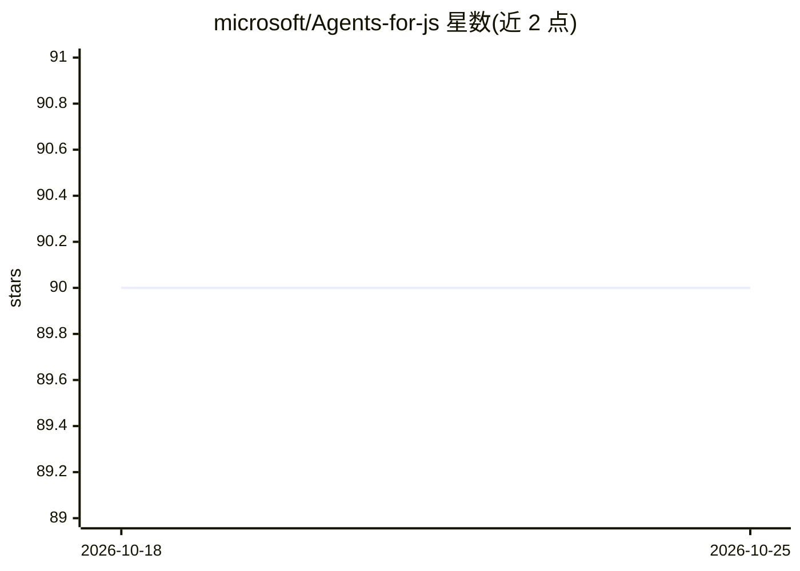

# microsoft/Agents-for-js

⭐ 90 · TypeScript · MIT · 推送 2026-10-23 · [GitHub](https://github.com/microsoft/Agents-for-js) · 组织维护

**微软官方的 Microsoft 365 Agent SDK JavaScript/TypeScript 组件库**

微软维护的 M365 Agent SDK 的 NodeJS/TypeScript 仓库，提供建构多渠道企业级 agent 的 NPM 组件包：Activity 协议类型、基于 Express/Fastify 的托管、Teams/Slack 扩展、遥测、Azure Blob/CosmosDB 存储扩展，以及与 Copilot Studio 所建 agent 交互的客户端。可集成 Azure AI Foundry SDK、Semantic Kernel 及第三方厂商 AI 组件。要求 Node.js 22+，提供 nightly 构建、sourcaps 调试与基于 debug 库的分类日志。多个包用于替代旧版 botbuilder 系列包。

## 筛选速览

| 维度 | 判定 | 备注 |
|---|---|---|
| AI 角色 | `ai-ecosystem` | LLM/agent 周边工具 |
| 许可风险 | `permissive` | MIT |
| 部署形态 | `None` |  |
| 模型依赖 | — | README 未给出锁定关系 |
| 硬件要求 | — | 无带数字的原话,不猜 |
| 安装摩擦 | `low` | 无编译、无系统依赖或容器化 |
| 成熟度 | — | 结构信号不足 |

## 能力要点

- 10 余个 NPM 组件包覆盖 Activity 协议、托管、Teams/Slack 扩展、遥测与存储
- @microsoft/agents-copilotstudio-client 直接与 Copilot Studio 中创建的 agent 交互
- 可集成 Azure AI Foundry SDK、Semantic Kernel 及第三方 AI 组件
- 支持 CommonJS/ES6/TypeScript，含 VSCode sourcemaps 调试与 DEBUG 分类日志

## 适用场景

- 构建部署到 Teams、M365、Webchat 的对话式 agent
- 用 Copilot Studio Client 在代码中调用 Copilot Studio 创建的 agent
- 将旧 botbuilder 项目迁移到新的 Agents SDK 组件包

## 场景标签

`Agent 框架` · 领域:Agent 开发

## 证据(README 行号)

> L6: The Microsoft 365 Agent SDK simplifies building full stack, multichannel, trusted agents for platforms including M36
> L8: The M365 Agent SDK is a comprehensive framework for building enterprise-grade agents, enabling developers to integra

## 星数曲线

2026-10-18 90 → 2026-10-25 90（+0）

---
*卡片 v1 · prompt 1.4 · 生成 2026-10-23 · 置信度 high · 依据 README sha `28ac2559a02c` · [字段定义](../../DATASET.md)*
