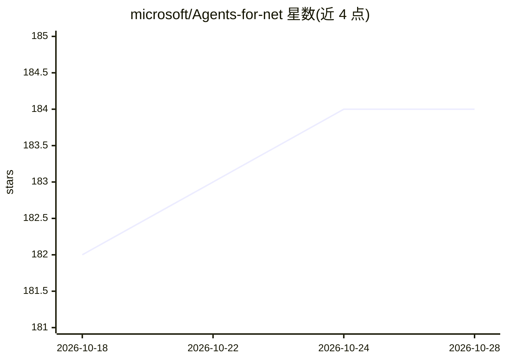

# microsoft/Agents-for-net

⭐ 184 · C# · MIT · 推送 2026-10-26 · [GitHub](https://github.com/microsoft/Agents-for-net) · 组织维护

**.NET 构建 M365/Teams 等平台多渠道 agent 的 SDK**

Microsoft 365 Agent SDK 的 C#/.NET 实现，用于构建覆盖 M365、Teams、Copilot Studio、Webchat 及 Facebook Messenger、Slack、Twilio 等第三方渠道的全栈 agent。SDK 提供处理用户交互、编排请求、推理响应与多 agent 协作的构建块，并支持接入 Azure AI Foundry SDK、Semantic Kernel 及其他厂商的 AI 组件。当前状态为 GA，通过 Nuget（Microsoft.Agents 前缀）分发，另有每日更新的 beta 包。仓库同时提供 AI 编码助手插件与本地 PR 评审 agent 配置。

## 筛选速览

| 维度 | 判定 | 备注 |
|---|---|---|
| AI 角色 | `ai-ecosystem` | LLM/agent 周边工具 |
| 许可风险 | `permissive` | MIT |
| 部署形态 | `None` |  |
| 模型依赖 | — | README 未给出锁定关系 |
| 硬件要求 | — | 无带数字的原话,不猜 |
| 安装摩擦 | `low` | 无编译、无系统依赖或容器化 |
| 成熟度 | — | 结构信号不足 |

## 能力要点

- 面向 M365/Teams/Copilot Studio/Webchat 及第三方渠道的 agent 构建框架
- 可集成 Azure AI Foundry SDK、Semantic Kernel 与其他厂商 AI 组件
- Nuget 公共源分发（Microsoft.Agents 前缀），另有每日构建 beta feed
- 附带 AI 编码助手插件与本地代码评审 agent（review/reviewer-github 循环）

## 适用场景

- 用 C#/.NET 构建部署到 Teams 或 M365 的企业 agent
- 通过统一 SDK 接入多个消息渠道（Slack、Facebook Messenger、Twilio）
- 在 agent 中编排 Azure AI Foundry / Semantic Kernel 组件

## 场景标签

`Agent 框架` `多智能体` · 领域:Agent 开发

## 证据(README 行号)

> L3: The Microsoft 365 Agent SDK simplifies building full stack, multichannel, trusted agents for platforms including M36
> L5: The M365 Agent SDK is a comprehensive framework for building enterprise-grade agents, enabling developers to integra

## 星数曲线

2026-10-18 182 → 2026-10-28 184（+2）

---
*卡片 v1 · prompt 1.4 · 生成 2026-10-22 · 置信度 high · 依据 README sha `7a40623a46a7` · [字段定义](../../DATASET.md)*
