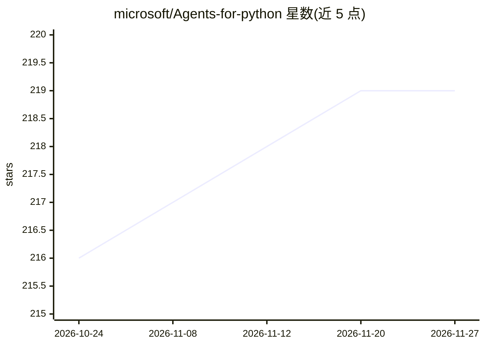

# microsoft/Agents-for-python

⭐ 219 · Python · MIT · 推送 2026-11-25 · [GitHub](https://github.com/microsoft/Agents-for-python) · 组织维护

**用 Python 构建 M365/Teams 等多渠道企业 Agent 的 SDK**

Microsoft 365 Agent SDK 的 Python 开发仓库，提供 PyPI 包用于构建面向 M365、Teams、Copilot Studio、Webchat 等平台的多渠道 Agent，并支持与 Facebook Messenger、Slack、Twilio 等第三方集成。核心机制包括 Activity 协议类型与校验、aiohttp/FastAPI 托管适配、瀑布式对话框系统、Azure Blob/CosmosDB 存储扩展与 MSAL/Entra 认证，另提供 Copilot Studio 客户端。要求 Python 3.11 及以上。

## 筛选速览

| 维度 | 判定 | 备注 |
|---|---|---|
| AI 角色 | `ai-ecosystem` | LLM/agent 周边工具 |
| 许可风险 | `permissive` | MIT |
| 部署形态 | `library` | 以包/库形式分发 |
| 模型依赖 | — | README 未给出锁定关系 |
| 硬件要求 | — | 无带数字的原话,不猜 |
| 安装摩擦 | `low` | 无编译、无系统依赖或容器化 |
| 成熟度 | — | 结构信号不足 |

## 能力要点

- 提供 hosting、dialogs、storage、authentication 等多个 PyPI 包
- aiohttp 与 FastAPI 两种托管运行方式
- 替代 botbuilder/botframework 系列旧包
- Copilot Studio Client 直接与 Copilot Studio 创建的 Agent 交互

## 适用场景

- 在 Teams/M365 平台构建企业级对话 Agent
- 集成 Azure AI Foundry SDK 与 Semantic Kernel 组件
- 为已有 Copilot Studio Agent 搭建直连客户端

## 场景标签

`Agent 框架` · 领域:Agent 开发

## 证据(README 行号)

> L6: The Microsoft 365 Agent SDK simplifies building full stack, multichannel, trusted agents for platforms including M36
> L18: We offer the following PyPI packages to create conversational experiences based on Agents:

## 星数曲线

2026-10-24 216 → 2026-11-27 219（+3）

---
*卡片 v1 · prompt 1.4 · 生成 2026-11-25 · 置信度 high · 依据 README sha `2f12ff1a8f01` · [字段定义](../../DATASET.md)*
