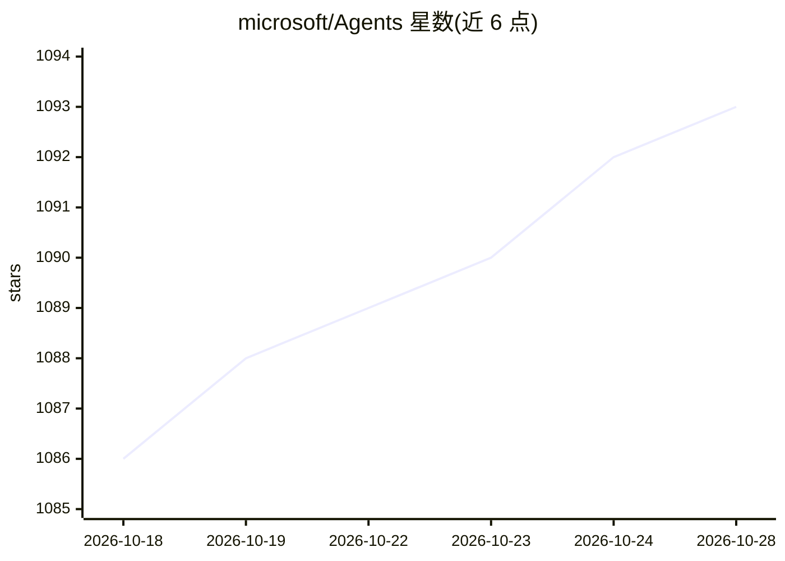

# microsoft/Agents

⭐ 1,093 · TypeScript · MIT · 推送 2026-10-28 · [GitHub](https://github.com/microsoft/Agents) · [官网](https://aka.ms/agentsdkdocs) · 组织维护

**微软官方构建多渠道企业 agent 的全栈 SDK 入口仓**

Microsoft 365 Agents SDK 用于创建可部署到 Microsoft 365 Copilot、Teams、Web/自定义应用等渠道的 agent，提供带状态、存储与活动/事件管理的 agent 容器和渠道管理能力。SDK 对所选 AI 服务保持中立，开发者可组合任意模型或服务实现 agentic 模式。本仓库为总入口，C#/.NET、JavaScript、Python 源码分别在各自语言仓库；仓库还提供 AI 编程助手插件（agent-plugins），并列举 Semantic Kernel、Azure AI Foundry、Copilot Studio 等相关平台。

## 筛选速览

| 维度 | 判定 | 备注 |
|---|---|---|
| AI 角色 | `ai-ecosystem` | LLM/agent 周边工具 |
| 许可风险 | `permissive` | MIT |
| 部署形态 | `None` |  |
| 模型依赖 | — | README 未给出锁定关系 |
| 硬件要求 | — | 无带数字的原话,不猜 |
| 安装摩擦 | `low` | 无编译、无系统依赖或容器化 |
| 成熟度 | — | 结构信号不足 |

## 能力要点

- agent 容器含状态、存储、活动与事件管理，可跨渠道部署
- 对 AI 服务与模型选择保持中立，不绑定特定技术栈
- C#/.NET、JavaScript、Python 三语言分仓提供源码
- 提供 GitHub Copilot CLI / Claude Code 的 SDK 知识插件

## 适用场景

- 构建部署到 Teams 或 M365 Copilot 的企业 agent
- 用自选 AI 服务组合实现 agentic 模式
- 将 Copilot Studio 构建的 agent 集成进自定义应用

## 场景标签

`Agent 框架` · 领域:Agent 开发

## 证据(README 行号)

> L3: With the Microsoft 365 Agents SDK, you can create agents deployable to channels of your choice, such as Microsoft 36
> L5: Developers need the flexibility to integrate agents from any provider or technology stack into their enterprise syst
> L81: The Microsoft 365 Agents SDK brings together core components to allow for developers to create, manage and utilize 

## 星数曲线

2026-10-18 1,086 → 2026-10-28 1,093（+7）

---
*卡片 v1 · prompt 1.4 · 生成 2026-10-21 · 置信度 high · 依据 README sha `c7268760038e` · [字段定义](../../DATASET.md)*
