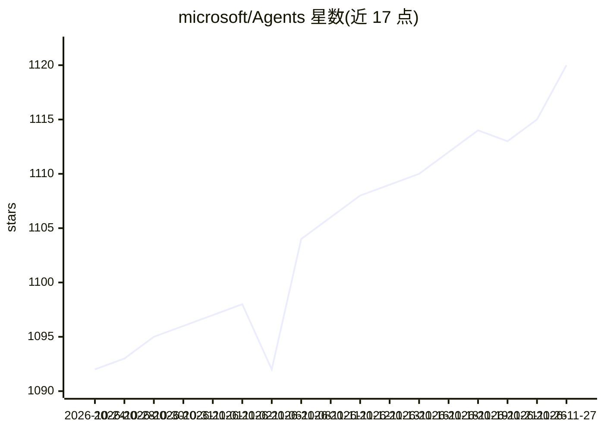

# microsoft/Agents

⭐ 1,120 · TypeScript · MIT · 推送 2026-11-25 · [GitHub](https://github.com/microsoft/Agents) · [官网](https://aka.ms/agentsdkdocs) · 组织维护

**微软多渠道 agent 构建接入 SDK：面向企业开发者**

Microsoft 365 Agents SDK 用于创建可部署到 Microsoft 365 Copilot、Teams、Web 与自定义应用等渠道的 agent，提供状态、存储、活动与事件管理所需的脚手架和渠道管理能力。AI 服务由开发者自选，SDK 不绑定特定技术栈。源码按 C#/.NET、JavaScript、Python 分别放在对应语言仓库，本仓库为入口与示例集合；另提供 GitHub Copilot CLI 与 Claude Code 可用的 agent-plugins 技能插件，通过 /plugin 命令安装。

## 筛选速览

| 维度 | 判定 | 备注 |
|---|---|---|
| AI 角色 | `ai-ecosystem` | LLM/agent 周边工具 |
| 许可风险 | `permissive` | MIT |
| 部署形态 | `None` |  |
| 模型依赖 | — | README 未给出锁定关系 |
| 硬件要求 | — | 无带数字的原话,不猜 |
| 安装摩擦 | `low` | 无编译、无系统依赖或容器化 |
| 成熟度 | — | 结构信号不足 |

## 能力要点

- 一次构建可部署到 Microsoft 365 Copilot、Teams、Web 等多个渠道
- AI 服务与技术栈无关，开发者自选模型或服务
- 提供 C#/.NET、JavaScript、Python 三种语言客户端仓库
- 提供 agents-sdk-common 等插件为 AI 编码助手注入 SDK 知识

## 适用场景

- 为企业构建接入 Teams 与 M365 Copilot 的多渠道 agent
- 在不绑定 AI 服务商的前提下实现 agentic 模式
- 通过 Copilot Studio 与自建 agent 组成多 agent 协作

## 场景标签

`Agent 框架` · 领域:Agent 开发

## 证据(README 行号)

> L3: With the Microsoft 365 Agents SDK, you can create agents deployable to channels of your choice, such as Microsoft 36
> L10: - Implement agentic patterns without being restricted to a specific technology stack. The Agents SDK is agnostic re
> L85: The Microsoft 365 Agents SDK brings together core components to allow for developers to create, manage and utilize 

## 星数曲线

2026-10-24 1,092 → 2026-11-27 1,120（+28）

---
*卡片 v1 · prompt 1.4 · 生成 2026-11-24 · 置信度 high · 依据 README sha `9f84c6e6fb98` · [字段定义](../../DATASET.md)*
