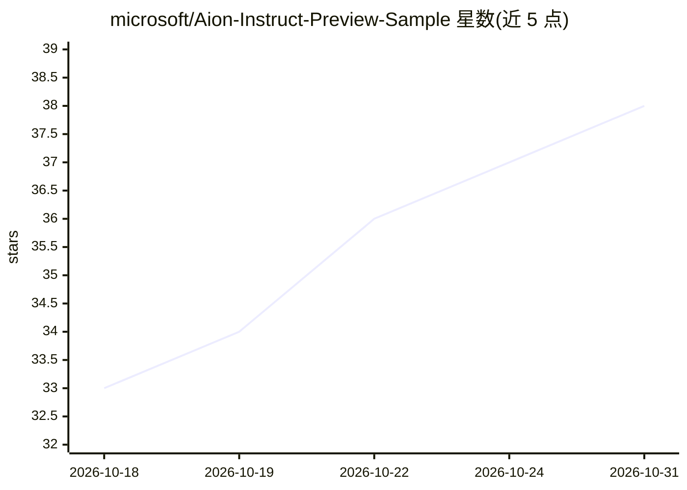

# microsoft/Aion-Instruct-Preview-Sample

⭐ 38 · PowerShell · NOASSERTION · 推送 2026-10-21 · [GitHub](https://github.com/microsoft/Aion-Instruct-Preview-Sample) · 组织维护

**在 Copilot+ PC 上运行 Aion Instruct 端侧模型的 WinUI 3 示例聊天应用**

微软提供的 WinUI 3 桌面示例应用，用于开发者验证 Aion Instruct Preview 端侧语言模型栈：在 ARM64 Snapdragon 与 x64 Intel Lunar Lake Copilot+ PC 上运行设备端推理，包含 Chat、图像描述、文本智能（摘要/改写/转表格，用内置任务适配器）与 LoRA 验证四个独立标签页。Bootstrap.ps1 脚本安装 Windows App Runtime、模型框架与 SDK NuGet 并构建启动。包仅供开发者验证，不得分发给最终用户；无 CPU 回退，性能为预览测量值。

## 筛选速览

| 维度 | 判定 | 备注 |
|---|---|---|
| AI 角色 | `ai-native` | 本体是模型或模型工具 |
| 许可风险 | `none` | NOASSERTION |
| 部署形态 | `desktop` | 安装包/桌面程序 |
| 模型依赖 | — | README 未给出锁定关系 |
| 硬件要求 | — | 无带数字的原话,不猜 |
| 安装摩擦 | `medium` | 含编译或系统依赖之一 |
| 成熟度 | `idea` | |

## 能力要点

- 端侧 LLM 推理：文本流式输出并显示首字延迟与每秒更新数
- 四个标签页：Chat / 图像描述 / 文本智能（内置任务适配器）/ LoRA 验证
- 可加载开发者训练的 LoRA 适配器进行基础模型与适配模型对比
- Bootstrap.ps1 一键检查运行时、下载框架与 SDK 并构建启动

## 适用场景

- 在 Copilot+ PC 上验证 Aion Instruct 模型栈的设备端推理
- 验证自训 LoRA 适配器与 Aion Instruct 的结构兼容性并对比输出
- 测试文本智能内置技能（摘要、改写、转表格）的效果

## 场景标签

`聊天机器人` `多模态` `AI 写作` · 领域:对话与助手

## 证据(README 行号)

> L3: A WinUI 3 desktop chat app that runs against the **AionInstructPreview** on-device language model on
> L8: Four independent tabs: **Chat**, **Describe image**, **Text intelligence**, and **LoRA validation**.
> L30: > This package is exclusively for developer validation of the new Aion Instruct model stack. It

## 星数曲线

2026-10-18 33 → 2026-10-31 38（+5）

---
*卡片 v1 · prompt 1.4 · 生成 2026-10-25 · 置信度 high · 依据 README sha `cc6fae2740c5` · [字段定义](../../DATASET.md)*
