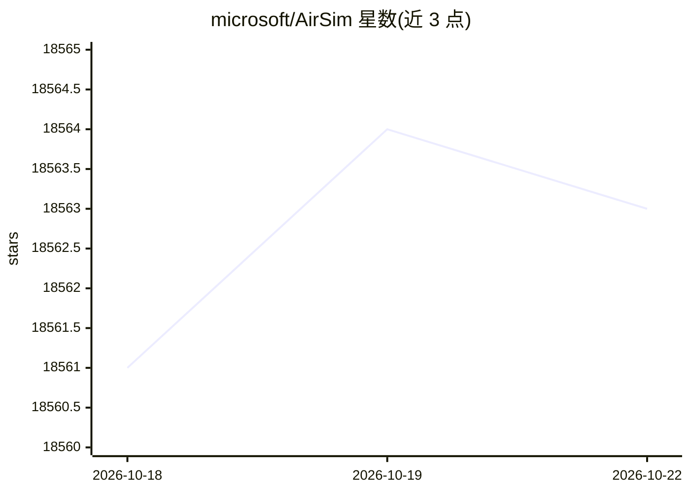

# microsoft/AirSim

⭐ 18,563 · C++ · NOASSERTION · 推送 2026-09-15 · [GitHub](https://github.com/microsoft/AirSim) · [官网](https://microsoft.github.io/AirSim/) · 组织维护

**无人机/自动驾驶仿真平台：供 AI 研究者做模拟实验**

基于 Unreal Engine（另有实验性 Unity 版本）的开源跨平台仿真器，支持无人机、汽车等载具的物理与视觉仿真。提供平台无关 API（C++/Python/C#/Java，经 RPC 暴露），可读取图像与状态、控制载具；支持 PX4、ArduPilot 的软件在环与 PX4 硬件在环仿真。提供录制位姿与图像生成训练数据、ComputerVision 模式收集深度/视差/分割等图像，以及 API 控制的天气效果。面向自主载具的深度学习、计算机视觉与强化学习研究。

## 筛选速览

| 维度 | 判定 | 备注 |
|---|---|---|
| AI 角色 | `ai-enhanced` | 去掉 AI 部分产品仍成立 |
| 许可风险 | `none` | NOASSERTION |
| 部署形态 | `None` |  |
| 模型依赖 | — | README 未给出锁定关系 |
| 硬件要求 | — | 无带数字的原话,不猜 |
| 安装摩擦 | `low` | 无编译、无系统依赖或容器化 |
| 成熟度 | — | 结构信号不足 |

## 动量与使用信号

- 维护:`active` — 距上次 push 32.7 天,年发版 0,194 位贡献者
- 涨星:近 1 天 **+0**(自 20261016 起算)
- 平台:WINDOWS / MACOS / LINUX · 协议:—

## 能力要点

- 通过 RPC 暴露多语言 API，读取图像/状态并控制载具
- 支持 PX4、ArduPilot 软件在环与 PX4 硬件在环仿真
- ComputerVision 模式可采集深度、视差、表面法线、分割图像
- 录制按钮一键生成位姿+图像训练数据

## 适用场景

- 在仿真中实验深度学习/强化学习的自主驾驶与飞行算法
- 采集带位姿标注的图像数据训练模型
- 在仿真器中写代码再迁移到真实载具（伴随计算机部署）
- 切换天气条件做计算机视觉实验

## 场景标签

`强化学习` `科研工具` · 领域:学习与行业

## 证据(README 行号)

> L3: AirSim is a simulator for drones, cars and more, built on Unreal Engine (we now also have an experimental Unity rele
> L7: Our goal is to develop AirSim as a platform for AI research to experiment with deep learning, computer vision and re
> L55: AirSim exposes APIs so you can interact with the vehicle in the simulation programmatically. You can use these APIs

## 星数曲线

2026-10-18 18,561 → 2026-10-22 18,563（+2）

---
*卡片 v1 · prompt 1.4 · 生成 2026-10-18 · 置信度 high · 依据 README sha `f5228c400121` · [字段定义](../../DATASET.md)*
