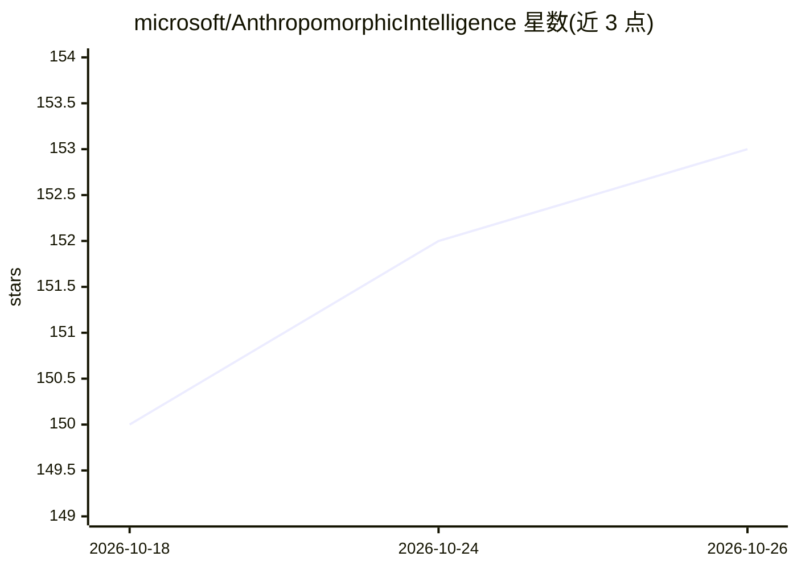

# microsoft/AnthropomorphicIntelligence

⭐ 153 · Python · MIT · 推送 2026-07-05 · [GitHub](https://github.com/microsoft/AnthropomorphicIntelligence) · 组织维护

**微软拟人化智能研究项目集：评测与推进类人心智的 AI**

微软维护的研究仓库，围绕“拟人化智能”收集并开发多项技术：PCC 嵌入式上下文压缩技术；MotiveBench（200 场景/600 任务的类人动机评测）、SocialCC（3,060 个跨 60 国文化能力场景）、LearnArena（LLM 学习能力评测）、PersonaArena（角色扮演模拟与多智能体评审）四个基准；HumanLLM 人类行为建模基础模型（基于 Cognitive Genome 数据集）；Proact-VL 实时主动交互 VideoLLM 框架（基于 Qwen-VL 系列）。README 未给出安装运行说明，各子项目细节需见各自目录。

## 筛选速览

| 维度 | 判定 | 备注 |
|---|---|---|
| AI 角色 | `ai-knowledge` | 知识聚合/清单类 |
| 许可风险 | `permissive` | MIT |
| 部署形态 | `None` |  |
| 模型依赖 | — | README 未给出锁定关系 |
| 硬件要求 | — | 无带数字的原话,不猜 |
| 安装摩擦 | `low` | 无编译、无系统依赖或容器化 |
| 成熟度 | — | 结构信号不足 |

## 能力要点

- 4 个评测基准：动机、文化能力、学习能力、角色扮演
- HumanLLM：基于多平台真实用户记录的人类行为建模模型
- PCC：嵌入式的长上下文压缩框架
- Proact-VL：基于 Qwen-VL 系列的实时主动视频交互框架

## 适用场景

- 评测 LLM 的类人动机与文化胜任力
- 构建拟人化 AI 陪伴或社会模拟研究
- 跟进微软在人类中心 AI 方向的研究产出

## 场景标签

`模型评测` · 领域:评测与运维

## 证据(README 行号)

> L21: This repository gathers and develops various techniques that contribute toward these objectives.
> L23: ## Techniques & Sub-Projects

## 星数曲线

2026-10-18 150 → 2026-10-26 153（+3）

---
*卡片 v1 · prompt 1.4 · 生成 2026-10-22 · 置信度 mid · 依据 README sha `c9d0e4dc355a` · [字段定义](../../DATASET.md)*
