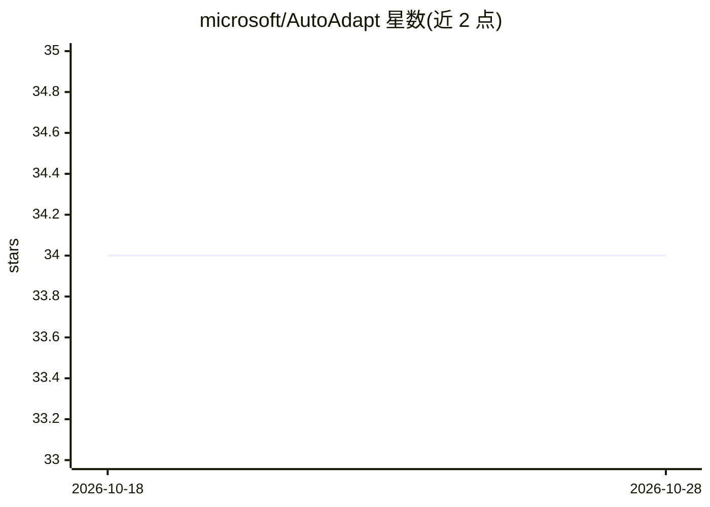

# microsoft/AutoAdapt

⭐ 34 · Python · MIT · 推送 2026-06-16 · [GitHub](https://github.com/microsoft/AutoAdapt) · [官网](https://www.microsoft.com/en-us/research/blog/autoadapt-automated-domain-adaptation-for-large-language-models/) · 组织维护

**微软的 LLM 自动领域适应框架：多智能体规划+超参优化**

论文官方实现，面向 LLM 领域适应（SFT/DPO/RAG）的端到端自动化框架。用文献与开源知识库减少专家干预，多智能体辩论系统（proposal 与 critic 迭代交互）对齐用户意图以缩小搜索空间，AutoRefine 作为 LLM 代理替代黑盒搜索做预算内超参优化。提供 CLI 与本地 React UI 两种使用方式，需配置 HF token、OpenAI API Key 与 Serp API Key。README 声明为研究性代码，非生产就绪系统，仅在英文基准数据集上测试。

## 筛选速览

| 维度 | 判定 | 备注 |
|---|---|---|
| AI 角色 | `ai-ecosystem` | LLM/agent 周边工具 |
| 许可风险 | `permissive` | MIT |
| 部署形态 | `library` | 以包/库形式分发 |
| 模型依赖 | — | README 未给出锁定关系 |
| 硬件要求 | — | 无带数字的原话,不猜 |
| 安装摩擦 | `low` | 无编译、无系统依赖或容器化 |
| 成熟度 | — | 结构信号不足 |

## 能力要点

- 多智能体辩论系统（proposal/critic）将用户意图与数据信号纳入规划
- AutoRefine：LLM 代理替代高成本黑盒超参搜索
- 支持 SFT/DPO/RAG 的领域适应模板
- 提供 CLI 与本地浏览器 React UI 两种入口

## 适用场景

- 自动化完成 LLM 在小数据专业领域的 SFT/DPO 适配
- 研究自动化超参优化与多智能体规划方法并复现基准
- 在紧凑预算下为领域任务搜索训练超参

## 场景标签

`多智能体` `微调` · 领域:Agent 开发

## 证据(README 行号)

> L5: This is the official implementation of AutoAdapt: An Automated Domain Adaptation Framework for Large Language Models
> L7: Large language models (LLMs) excel in open domains but struggle in specialized settings with limited data and evolvi
> L25: AutoAdapt supports **two ways of usage**:

## 星数曲线

2026-10-18 34 → 2026-10-28 34（+0）

---
*卡片 v1 · prompt 1.4 · 生成 2026-10-25 · 置信度 mid · 依据 README sha `ecc50f61ab6d` · [字段定义](../../DATASET.md)*
