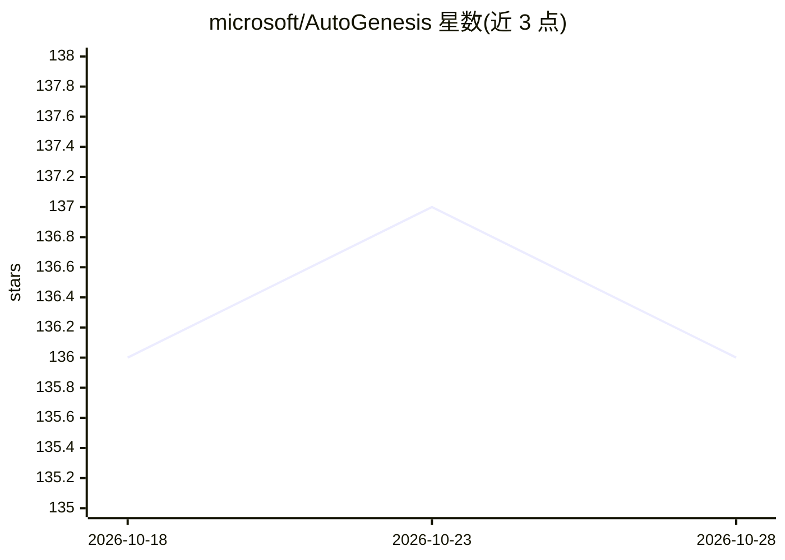

# microsoft/AutoGenesis

⭐ 136 · TypeScript · NOASSERTION · 推送 2026-10-28 · [GitHub](https://github.com/microsoft/AutoGenesis) · 组织维护 · 中文 README

**微软的 MCP 自动化测试框架，覆盖桌面与移动应用**

基于 Model Context Protocol (MCP) 的自动化测试框架，包含三个 MCP server（appium-mcp-server 用于移动/mac 自动化、pywinauto-mcp-server 用于 Windows 自动化）和一个 VS Code 扩展（BDD AI Toolkit）。支持 Windows/macOS 桌面应用与 iOS/Android 移动应用的自动化测试，提供 AI 辅助测试脚本生成、BDD 测试录制与一键回放、自然语言转自动化代码，移动端集成 BrowserStack 云测试。各平台安装说明放在各自子 README 中，主 README 未给出具体安装命令；默认向官方 Application Insights 上报使用数据。

## 筛选速览

| 维度 | 判定 | 备注 |
|---|---|---|
| AI 角色 | `ai-ecosystem` | LLM/agent 周边工具 |
| 许可风险 | `none` | NOASSERTION |
| 部署形态 | `None` |  |
| 模型依赖 | — | README 未给出锁定关系 |
| 硬件要求 | — | 无带数字的原话,不猜 |
| 安装摩擦 | `medium` | 含编译或系统依赖之一 |
| 成熟度 | — | 结构信号不足 |

## 能力要点

- 三个 MCP server 组件分别覆盖移动/mac 与 Windows 自动化
- VS Code 扩展支持 AI BDD 测试录制与一键回放
- 自然语言生成自动化代码，GitHub Copilot 经 MCP 集成
- 移动端集成 BrowserStack 云测试

## 适用场景

- 为 Windows/macOS 桌面应用编写自动化测试
- 对 iOS/Android 应用做自动化与云测试
- 在 VS Code 中录制并回放 BDD 测试，用自然语言生成测试代码

## 场景标签

`GUI 自动化` `代码生成` · 领域:效率与自动化

## 证据(README 行号)

> L5: AutoGenesis is an AI-powered automated testing framework based on Model Context Protocol (MCP), supporting multiple 
> L62:  ├── appium-mcp-server/ # MCP server for mobile/mac automation
> L66:  ├── pywinauto-mcp-server/ # MCP server for Windows automation

## 星数曲线

2026-10-18 136 → 2026-10-28 136（+0）

---
*卡片 v1 · prompt 1.4 · 生成 2026-10-22 · 置信度 high · 依据 README sha `62888858f0e6` · [字段定义](../../DATASET.md)*
