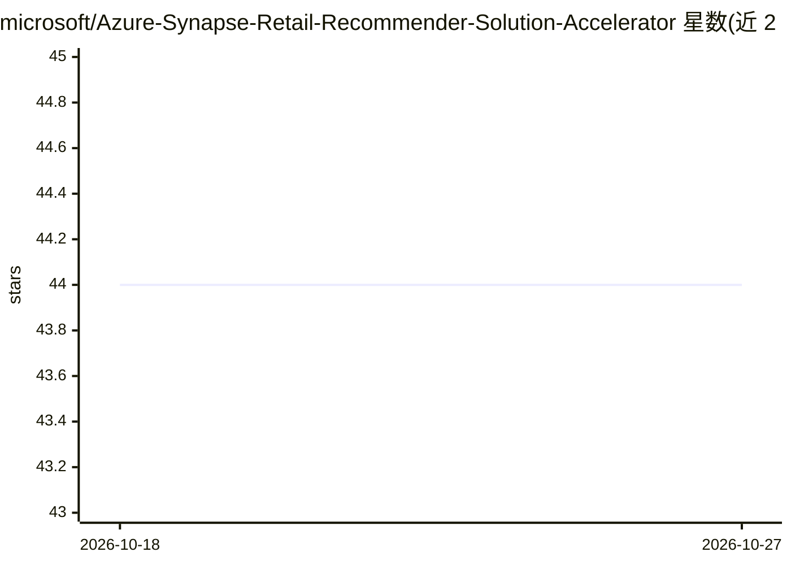

# microsoft/Azure-Synapse-Retail-Recommender-Solution-Accelerator

⭐ 44 · TypeScript · MIT · 推送 2026-05-09 · [GitHub](https://github.com/microsoft/Azure-Synapse-Retail-Recommender-Solution-Accelerator) · 组织维护

**Azure 零售推荐系统端到端解决方案加速器，面向开发者**

微软提供的解决方案加速器：基于 Azure Synapse Analytics、Azure Cosmos DB、Azure Machine Learning 与 Azure Data Lake Storage 构建零售个性化推荐系统的端到端示例。仓库按资源部署、分析 Notebook、前端 Web 应用、后端 API、ML 模型构建等文件夹组织资源，需自备 Azure 订阅及 Visual Studio、PowerShell、Azure CLI、Postman 等环境，假定用户具备 Cosmos DB、Azure ML 与 AKS 的基础知识。

## 筛选速览

| 维度 | 判定 | 备注 |
|---|---|---|
| AI 角色 | `ai-ecosystem` | LLM/agent 周边工具 |
| 许可风险 | `permissive` | MIT |
| 部署形态 | `library` | 以包/库形式分发 |
| 模型依赖 | — | README 未给出锁定关系 |
| 硬件要求 | — | 无带数字的原话,不猜 |
| 安装摩擦 | `low` | 无编译、无系统依赖或容器化 |
| 成熟度 | — | 结构信号不足 |

## 能力要点

- 覆盖资源部署、Notebook 分析、前后端应用与 ML 模型构建的完整流程
- 依赖 Azure Synapse、Cosmos DB、Azure ML、AKS 等多项云服务
- 提供部署指南与架构图说明

## 适用场景

- 在 Azure 上快速搭建零售个性化推荐参考实现
- 学习推荐系统在 Azure 数据与 ML 服务栈中的架构组织方式

## 场景标签

`推荐系统` · 领域:学习与行业

## 证据(README 行号)

> L12: This accelerator was built to provide developers with all of the resources needed to quickly build an Retail Recomm
> L53: ### 4. ML Model Building

## 星数曲线

2026-10-18 44 → 2026-10-27 44（+0）

---
*卡片 v1 · prompt 1.4 · 生成 2026-10-25 · 置信度 low · 依据 README sha `0a5ab42b20fe` · [字段定义](../../DATASET.md)*
