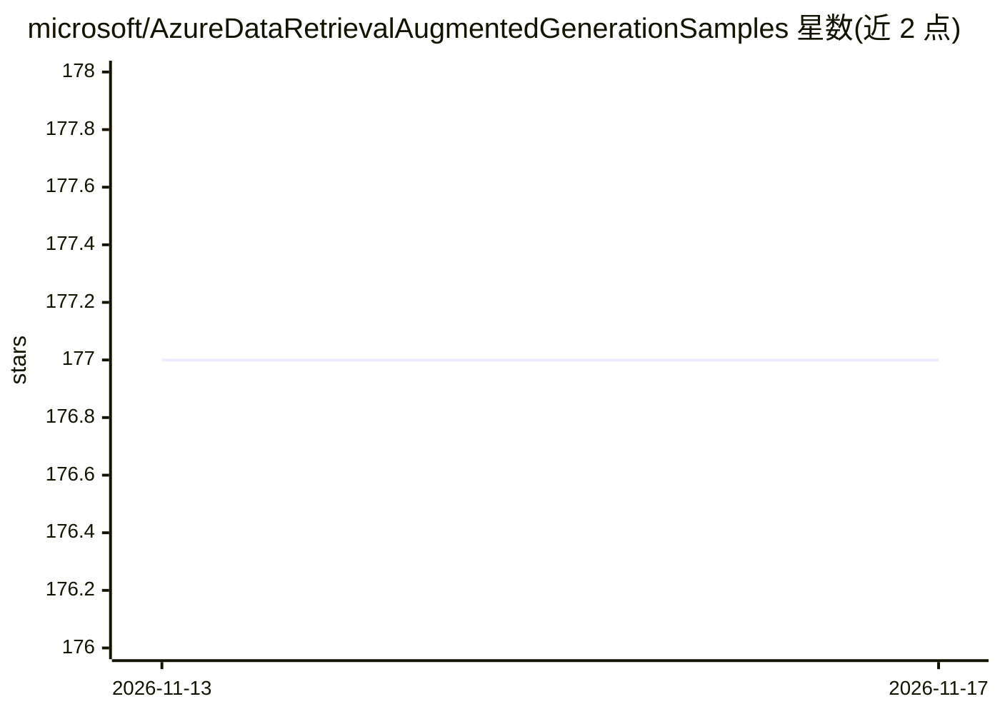

# microsoft/AzureDataRetrievalAugmentedGenerationSamples

⭐ 177 · Jupyter Notebook · MIT · 推送 2026-11-13 · [GitHub](https://github.com/microsoft/AzureDataRetrievalAugmentedGenerationSamples) · 组织维护

**微软官方 Azure 数据 RAG 示例代码集合：演示接入多种 Azure 数据库**

微软维护的示例仓库，演示在 Azure 数据产品上实现检索增强生成（RAG）的路径：将数据加入 Azure 数据库，用 Azure OpenAI Embeddings 生成向量，借助 Azure Cognitive Search 或原生向量索引建立索引，再做向量相似度检索与问答。覆盖 PostgreSQL、CosmosDB（MongoDB/PostgreSQL/NoSQL）、Redis、AzureSQL、Fabric OneLake 等，示例以 Python、C#、Java 提供。README 未给出具体安装运行命令，且维护者章节为未完成模板。

## 筛选速览

| 维度 | 判定 | 备注 |
|---|---|---|
| AI 角色 | `ai-knowledge` | 知识聚合/清单类 |
| 许可风险 | `permissive` | MIT |
| 部署形态 | `None` |  |
| 模型依赖 | locked-api |  |
| 硬件要求 | — | 无带数字的原话,不猜 |
| 安装摩擦 | `low` | 无编译、无系统依赖或容器化 |
| 成熟度 | — | 结构信号不足 |

## 能力要点

- 覆盖 8 类 Azure 数据产品的 RAG 路径指引表
- 示例含 Python、C#、Java 多种语言
- 演示 Embeddings + 向量索引 + 检索问答的完整流程

## 适用场景

- 在 Azure 数据库上搭建 RAG 方案时查找参考实现
- 比较各 Azure 数据产品的向量索引支持情况
- 学习 RAG 端到端流程的官方示例代码

## 场景标签

`RAG` · 领域:知识与检索

## 证据(README 行号)

> L3: This repo contains code samples and links to help you get started with retrieval augmentation generation (RAG) on Az
> L17: |Azure data product|Native vector indexing OR Azure Cognitive Search (ACS)|Guidance: repo, blog or docs|

## 星数曲线

2026-11-13 177 → 2026-11-17 177（+0）

---
*卡片 v1 · prompt 1.4 · 生成 2026-11-17 · 置信度 high · 依据 README sha `1a1b3e0f6ab4` · [字段定义](../../DATASET.md)*
