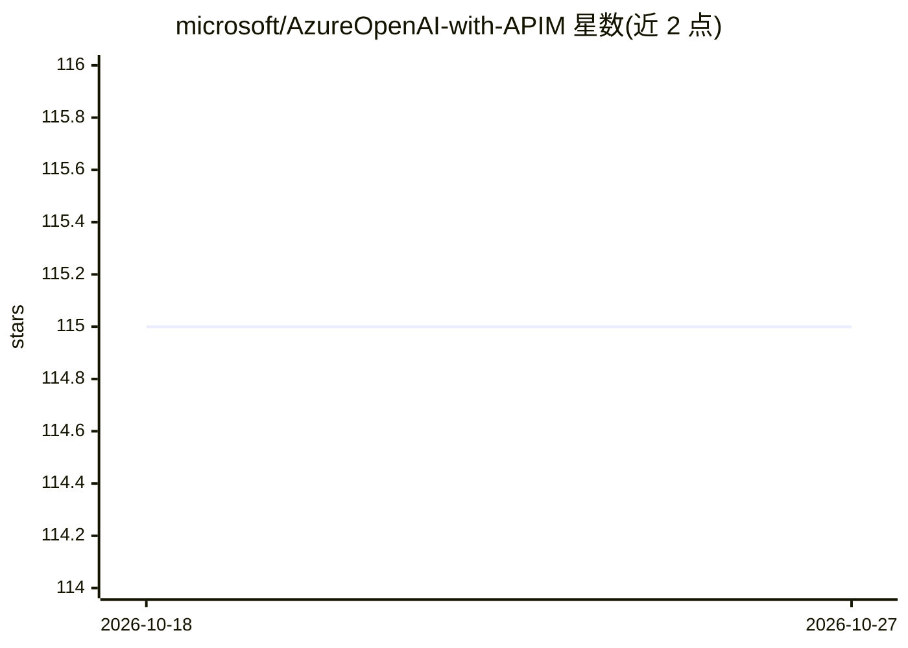

# microsoft/AzureOpenAI-with-APIM

⭐ 115 · Bicep · MIT · 推送 2026-03-30 · [GitHub](https://github.com/microsoft/AzureOpenAI-with-APIM) · 组织维护

**一键部署 APIM 网关并自动配置对接 Azure OpenAI 的方案仓库**

面向企业（含 Azure Government）的 Azure 方案仓库：提供一键部署 API Management、Key Vault 与 Log Analytics 并自动配置 APIM 对接 Azure OpenAI 端点的两类部署方案（含私有端点版本）。内容覆盖重试/多区域弹性、负载均衡、PTU 性能、基于 Priority 头的路由策略、按订阅的 token 计量与计费回收、成本管理以及 Managed Identity/订阅密钥等访问控制。属于部署指南与策略配置的集合，需自备 Azure 订阅与已部署的 Azure OpenAI 服务作为前提。

## 筛选速览

| 维度 | 判定 | 备注 |
|---|---|---|
| AI 角色 | `ai-ecosystem` | LLM/agent 周边工具 |
| 许可风险 | `permissive` | MIT |
| 部署形态 | `None` |  |
| 模型依赖 | locked-api |  |
| 硬件要求 | — | 无带数字的原话,不猜 |
| 安装摩擦 | `medium` | 含编译或系统依赖之一 |
| 成熟度 | — | 结构信号不足 |

## 能力要点

- 一键部署 APIM + Key Vault + Log Analytics 并自动配置对接 Azure OpenAI
- 基于 HTTP Priority 头（0-1000）的路由策略示例（PTU/区域/数据区/熔断池）
- 按订阅统计 token 用量，支撑计费回收模型（Event Hub + Azure Function + Log Analytics）
- 覆盖多区域重试、负载均衡、速率限制与 Managed Identity 访问控制

## 适用场景

- 企业集中管控 Azure OpenAI 访问，按订阅发放密钥而非共享原始 key
- 多区域多端点提升 Azure OpenAI 的弹性与吞吐配额
- 按部门/订阅统计 token 用量并做内部成本分摊与预测

## 场景标签

`模型网关` · 领域:Agent 开发

## 证据(README 行号)

> L15: One-button deploy APIM, Key vault, and Log Analytics. Auto-configure APIM to work with your Azure OpenAI endpoint.
> L17: Using Azure's APIM orchestration provides a organizations with a powerful way to scale and manage their Azure OpenA

## 星数曲线

2026-10-18 115 → 2026-10-27 115（+0）

---
*卡片 v1 · prompt 1.4 · 生成 2026-10-23 · 置信度 high · 依据 README sha `8515a619a04a` · [字段定义](../../DATASET.md)*
