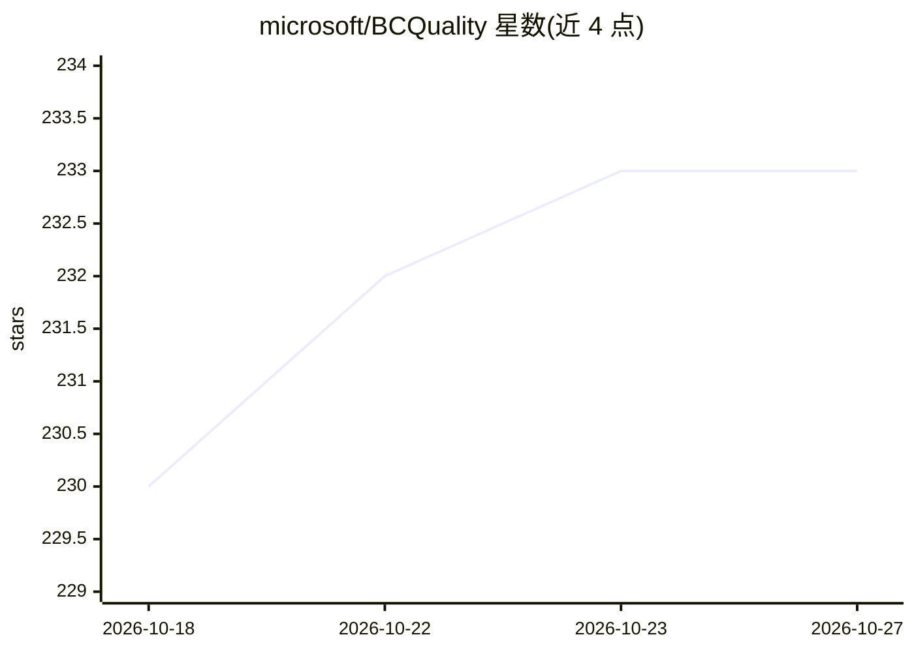

# microsoft/BCQuality

⭐ 233 · AL · MIT · 推送 2026-10-26 · [GitHub](https://github.com/microsoft/BCQuality) · 组织维护

**面向 Business Central 开发的 AI 质量知识与技能库**

微软维护的 Business Central（BC）开发质量知识库：以知识条目与可复用技能形式提供，本体不是 agent 也不是 BC 扩展，由宿主（如 GitHub Copilot CLI 插件）调用。提供 al-code-review 技能按需审查 AL 代码并输出带位置、严重度、置信度与依据的 findings-report；preview 状态的 al-plan-guidance 技能对开发计划做只读的约束补充。内容分 Microsoft/Community/Custom 三层，覆盖 AL 技术审查及部分 SCM 与 Finance 领域，明确声明不替代编译器、分析器与人工审查。

## 筛选速览

| 维度 | 判定 | 备注 |
|---|---|---|
| AI 角色 | `ai-knowledge` | 知识聚合/清单类 |
| 许可风险 | `permissive` | MIT |
| 部署形态 | `None` |  |
| 模型依赖 | — | README 未给出锁定关系 |
| 硬件要求 | — | 无带数字的原话,不猜 |
| 安装摩擦 | `low` | 无编译、无系统依赖或容器化 |
| 成熟度 | `idea` | |

## 能力要点

- al-code-review 技能输出带来源位置、严重度、置信度的审查报告
- al-plan-guidance（preview）对开发计划做只读指导补充
- Microsoft/Community/Custom 三层知识与技能结构，支持组织 fork 覆盖
- Entry 路由可供 CI 集成直接调用，与插件走相同规则

## 适用场景

- 我在 Business Central 项目里让 AI 工具审查 AL 代码的 BC 特有缺陷
- 编码前用 BCQuality 约束补充我的开发计划
- 在 CI/AL-Go 流水线中自动审查 BC 仓库（开发中）

## 场景标签

`代码审查` · 领域:编码与开发

## 证据(README 行号)

> L7: BCQuality contains **knowledge and reusable skills**, not agents or a Business
> L8: Central extension. Your host supplies the agent. You can install the content

## 星数曲线

2026-10-18 230 → 2026-10-27 233（+3）

---
*卡片 v1 · prompt 1.4 · 生成 2026-10-22 · 置信度 high · 依据 README sha `c53892532530` · [字段定义](../../DATASET.md)*
