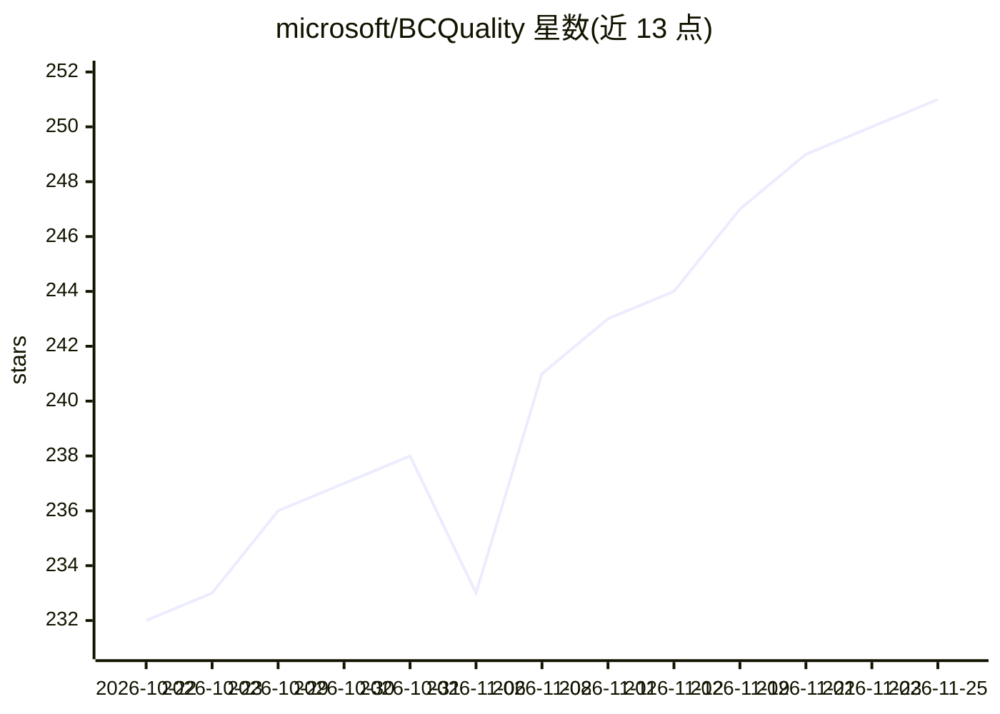

# microsoft/BCQuality

⭐ 251 · AL · MIT · 推送 2026-11-20 · [GitHub](https://github.com/microsoft/BCQuality) · 组织维护

**为 AI 工具提供 Business Central 开发质量知识与技能库**

BCQuality 是面向 Business Central（AL 语言）开发的知识与可复用技能仓库，本身不含 agent 或 BC 扩展，由宿主 agent 提供执行能力。内容含 229 篇知识文章与三项能力：AL 代码审查（al-code-review）、带引用的知识问答（al-knowledge）、开发计划指导（al-plan-guidance，预览）。通过 Copilot CLI 插件安装使用，也可由 CI 等集成直接调用 Entry 路由。当前覆盖技术代码审查与 SCM、Finance 部分功能域，明确不替代编译器、分析器、测试或人工审查。

## 筛选速览

| 维度 | 判定 | 备注 |
|---|---|---|
| AI 角色 | `ai-knowledge` | 知识聚合/清单类 |
| 许可风险 | `permissive` | MIT |
| 部署形态 | `None` |  |
| 模型依赖 | — | README 未给出锁定关系 |
| 硬件要求 | — | 无带数字的原话,不猜 |
| 安装摩擦 | `low` | 无编译、无系统依赖或容器化 |
| 成熟度 | — | 结构信号不足 |

## 能力要点

- 229 篇社区与 Microsoft 知识文章，分 Microsoft/Community/Custom 三层组织
- 三项能力：代码审查、带引用知识问答、计划指导（预览）
- copilot plugin install 一条命令安装，CI 集成可直连 Entry 路由
- 审查结果含源码位置、严重度、置信度与对应指导引用

## 适用场景

- 用 Copilot CLI 对 Business Central AL 应用做 BC 专项代码审查
- 在 AL-Go 仓库中对拉取请求自动运行代码审查
- 编码前让 al-plan-guidance 为开发计划补充约束与校验要点
- 开发中查询 BC 开发问题并获得可追溯引用的回答

## 场景标签

`代码审查` `文档问答` · 领域:编码与开发

## 证据(README 行号)

> L7: BCQuality contains **knowledge and reusable skills**, not agents or a Business
> L165: Knowledge articles cover one concern each. Skills tell an agent how to find

## 星数曲线

2026-10-22 232 → 2026-11-25 251（+19）

---
*卡片 v1 · prompt 1.4 · 生成 2026-11-25 · 置信度 high · 依据 README sha `5400e993969c` · [字段定义](../../DATASET.md)*
