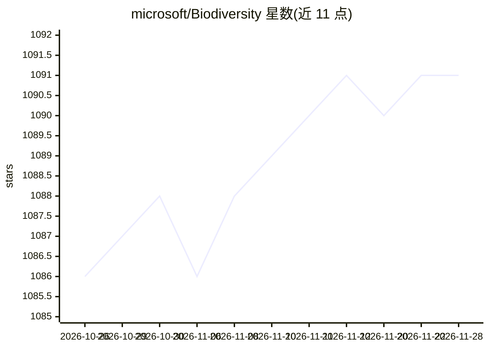

# microsoft/Biodiversity

⭐ 1,091 · HTML · MIT · 推送 2026-11-17 · [GitHub](https://github.com/microsoft/Biodiversity) · [官网](https://microsoft.github.io/Biodiversity/) · 组织维护

**Microsoft 保护生物学 AI 项目群目录：SPARROW 生态导航**

Microsoft AI for Good Lab 维护的目录型仓库，将 SPARROW 生态下的生物多样性监测项目聚合导航：覆盖相机陷阱检测（MegaDetector）、物种分类、声学分析、无人机影像检测、推理引擎（Sparrow Engine，Rust + ONNX Runtime）、野外数据接收（Sparrow Comm）与太阳能野外硬件（SPARROW/SPARROWmini）。仓库本身不含可直接安装的代码，主要提供项目清单、任务到项目的匹配指引、PyTorch-Wildlife 更名与迁移说明及引用文献信息。

## 筛选速览

| 维度 | 判定 | 备注 |
|---|---|---|
| AI 角色 | `ai-knowledge` | 知识聚合/清单类 |
| 许可风险 | `permissive` | MIT |
| 部署形态 | `library` | 以包/库形式分发 |
| 模型依赖 | — | README 未给出锁定关系 |
| 硬件要求 | — | 无带数字的原话,不猜 |
| 安装摩擦 | `low` | 无编译、无系统依赖或容器化 |
| 成熟度 | — | 结构信号不足 |

## 能力要点

- SPARROW 生态全部公开项目的目录与任务匹配指引
- PyTorch-Wildlife 更名为 SPARROW Playground，旧包止于 1.3.1
- Sparrow Engine 通过 pip 或 Homebrew 分发，含模型 zoo
- SPARROWmini（Raspberry Pi Zero 2 W）在设备端运行检测

## 适用场景

- 为野生动物监测项目挑选合适的相机陷阱检测模型
- 查找野外声学物种识别的工具链
- 了解从野外设备到云端的数据链路组件

## 场景标签

`科研工具` `目标检测` `精选清单` · 领域:学习与行业

## 证据(README 行号)

> L6: Microsoft AI for Good Lab: the SPARROW ecosystem for camera-trap detection, bioacoustic analysis, species classifica
> L18: We now bring all of it together under one name: **SPARROW**. Each project has its own repository, so the code is ea
> L41: Not sure where to start? The project catalogue matches common tasks to projects and links the model zoo.

## 星数曲线

2026-10-26 1,086 → 2026-11-28 1,091（+5）

---
*卡片 v1 · prompt 1.4 · 生成 2026-11-24 · 置信度 high · 依据 README sha `9ea43d917a52` · [字段定义](../../DATASET.md)*
