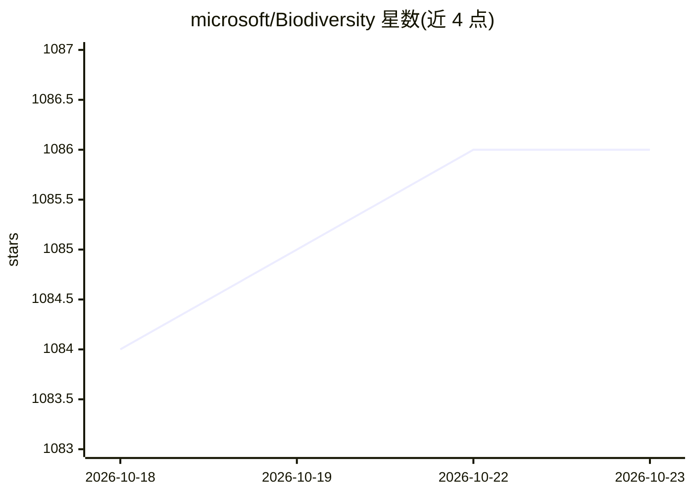

# microsoft/Biodiversity

⭐ 1,086 · Python · MIT · 推送 2026-10-21 · [GitHub](https://github.com/microsoft/Biodiversity) · [官网](https://microsoft.github.io/Biodiversity/) · 组织维护

**微软生物多样性 AI 项目集线仓库：聚合各保护 AI 子项目**

Microsoft AI for Good Lab 的生物多样性研究集线仓库：本仓库自身不含模型代码，而是将原单一大仓库拆分后的各专项项目以表格形式聚合链接，包括相机陷阱动物检测 MegaDetector、生物声学 MegaDetector-Acoustic、物种分类微调、航拍/声呐野生动物检测、PyTorch-Wildlife 框架与 SPARROW 太阳能边缘录音设备。各子项目代码迁移至独立仓库，此处提供导航、引用规范（citation.cff）与贡献指引。

## 筛选速览

| 维度 | 判定 | 备注 |
|---|---|---|
| AI 角色 | `ai-knowledge` | 知识聚合/清单类 |
| 许可风险 | `permissive` | MIT |
| 部署形态 | `None` |  |
| 模型依赖 | — | README 未给出锁定关系 |
| 硬件要求 | — | 无带数字的原话,不猜 |
| 安装摩擦 | `low` | 无编译、无系统依赖或容器化 |
| 成熟度 | — | 结构信号不足 |

## 能力要点

- 聚合 MegaDetector、PyTorch-Wildlife、SPARROW 等 7 个子项目链接
- 覆盖相机陷阱检测、生物声学、航拍/声呐检测与边缘设备
- 提供统一引用规范与 citation.cff 自动引用文件

## 适用场景

- 查找微软生物多样性监测相关的各子项目仓库
- 为使用 MegaDetector 等模型的研究工作查找引用条目

## 场景标签

`精选清单` · 领域:学习与行业

## 证据(README 行号)

> L20: So we made a deliberate decision: break the work into focused, dedicated repositories — one per project — where the
> L27: |Repo|What it is|
> L34: |microsoft/Pytorch-Wildlife|The collaborative deep learning framework and model zoo for conservation AI|

## 星数曲线

2026-10-18 1,084 → 2026-10-23 1,086（+2）

---
*卡片 v1 · prompt 1.4 · 生成 2026-10-21 · 置信度 high · 依据 README sha `62b8e873bc2e` · [字段定义](../../DATASET.md)*
