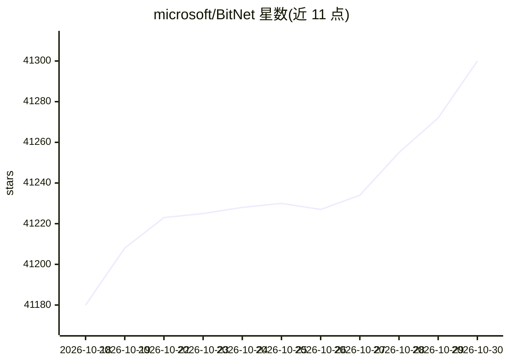

# microsoft/BitNet

⭐ 41,300 · C++ · MIT · 推送 2026-07-27 · [GitHub](https://github.com/microsoft/BitNet) · 组织维护

**1-bit 大模型的官方 CPU/GPU 推理框架**

bitnet.cpp 是 1-bit LLM（如 BitNet b1.58）的官方推理框架，提供 I2_S/TL1/TL2 等优化内核，支持在 x86 与 ARM CPU 及 GPU 上运行，并附 CPU/GPU 推理基准脚本与 .safetensors 转 gguf 的转换脚本。官方在 Hugging Face 发布 BitNet-b1.58-2B-4T 与两个 embedding 模型，社区模型列表含 Llama3-8B-1.58、Falcon3/Falcon-E 家族。构建需 python>=3.10、cmake>=3.22、clang>=18，Windows 需 Visual Studio 2022，从源码克隆编译后经 setup_env.py 下载/量化模型运行。

## 筛选速览

| 维度 | 判定 | 备注 |
|---|---|---|
| AI 角色 | `ai-native` | 本体是模型或模型工具 |
| 许可风险 | `permissive` | MIT |
| 部署形态 | `library` | 以包/库形式分发 |
| 模型依赖 | — | README 未给出锁定关系 |
| 硬件要求 | — | 无带数字的原话,不猜 |
| 安装摩擦 | `medium` | 含编译或系统依赖之一 |
| 成熟度 | — | 结构信号不足 |

## 动量与使用信号

- 维护:`active` — 距上次 push 83.1 天,年发版 0,16 位贡献者
- 涨星:近 1 天 **+4**(自 20261016 起算)

## 能力要点

- 提供 I2_S、TL1、TL2 三种内核，按模型与 CPU 架构列出支持矩阵
- 支持对话模式（-cnv）与线程数、上下文、温度等推理参数
- 提供端到端基准脚本与 dummy 模型生成脚本用于本机测试
- 支持从 .safetensors 检查点转换为 gguf 模型

## 适用场景

- 在本地 CPU 上运行 1-bit/ternary 模型做文本生成
- 对 BitNet 类模型做推理性能基准测试
- 将 safetensors 检查点转换为 gguf 并量化推理
- 在资源受限设备上部署小型 embedding 模型

## 场景标签

`推理引擎` `模型量化` · 领域:训练与推理

## 证据(README 行号)

> L44: bitnet.cpp is the official inference framework for 1-bit LLMs (e.g., BitNet b1.58). It offers a suite of optimized 
> L204: ## Installation
> L221: ### Build from source

## 星数曲线

2026-10-18 41,180 → 2026-10-30 41,300（+120）

---
*卡片 v1 · prompt 1.4 · 生成 2026-10-18 · 置信度 high · 依据 README sha `daad01d1a92a` · [字段定义](../../DATASET.md)*
