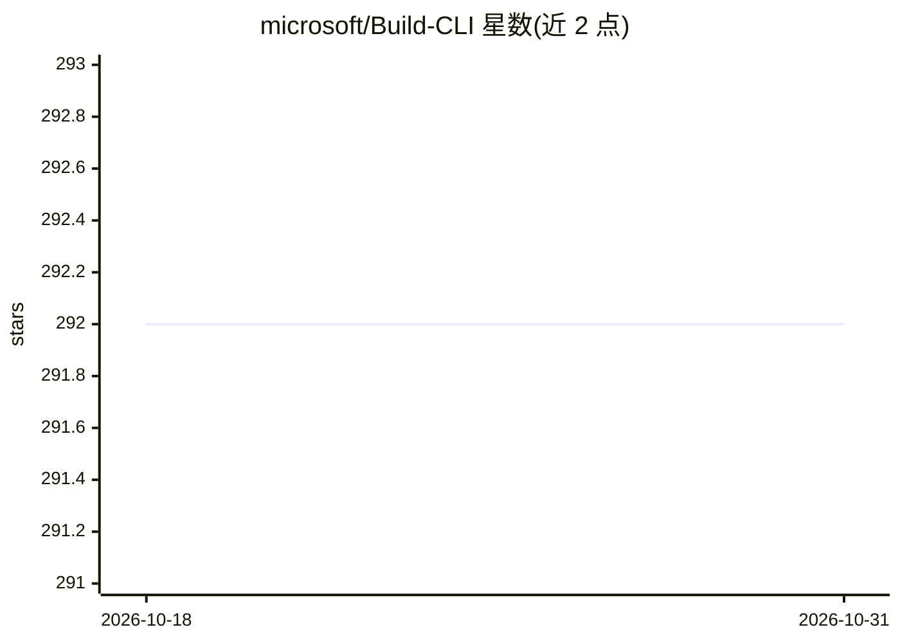

# microsoft/Build-CLI

⭐ 292 · TypeScript · MIT · 推送 2026-10-30 · [GitHub](https://github.com/microsoft/Build-CLI) · [官网](https://build.microsoft.com) · 组织维护

**在终端里连接 Microsoft Build 会议目录的 Copilot CLI 技能**

一个 GitHub Copilot CLI skill（插件），把本地项目与 Microsoft Build 2026 在线 session 目录连接起来：读取 package.json、requirements.txt、.csproj、go.mod 等依赖文件，映射到 Microsoft 产品并检索相关会议场次；还支持记录会议笔记、按 session 生成项目脚手架，SDK 文档回退到 Microsoft Learn MCP Server。提供 GitHub Copilot CLI、VS Code、Visual Studio 2026、Claude Code 四种客户端的安装方式。需网络访问；Node.js 22+ 为可选加速项。

## 筛选速览

| 维度 | 判定 | 备注 |
|---|---|---|
| AI 角色 | `ai-ecosystem` | LLM/agent 周边工具 |
| 许可风险 | `permissive` | MIT |
| 部署形态 | `None` |  |
| 模型依赖 | — | README 未给出锁定关系 |
| 硬件要求 | — | 无带数字的原话,不猜 |
| 安装摩擦 | `low` | 无编译、无系统依赖或容器化 |
| 成熟度 | — | 结构信号不足 |

## 能力要点

- 读取项目依赖文件并映射到 Microsoft 产品，检索 Build 2026 会议目录
- 支持会议前规划日程、会中记笔记、会后从 session 脚手架生成项目
- 覆盖 GitHub Copilot CLI / VS Code / Visual Studio 2026 / Claude Code 四种客户端

## 适用场景

- 会前根据我的技术栈找相关 Build 会议场次
- 会中把笔记记录到对应 session 下
- 会后按 session 内容生成项目脚手架并查看产品变化

## 场景标签

`代码生成` · 领域:编码与开发

## 证据(README 行号)

> L3: A GitHub Copilot CLI skill that connects your local project to the Microsoft Build session catalog. It reads your de
> L11:    /plugin install microsoft/Build-CLI

## 星数曲线

2026-10-18 292 → 2026-10-31 292（+0）

---
*卡片 v1 · prompt 1.4 · 生成 2026-10-22 · 置信度 high · 依据 README sha `d2af073c1aab` · [字段定义](../../DATASET.md)*
