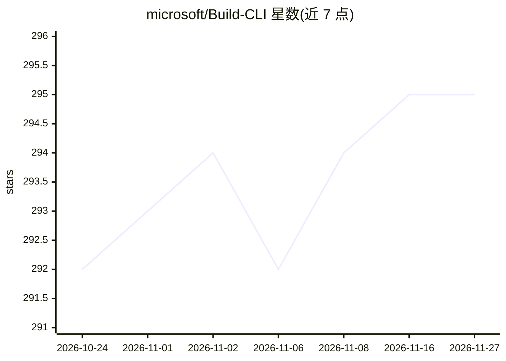

# microsoft/Build-CLI

⭐ 295 · TypeScript · MIT · 推送 2026-11-09 · [GitHub](https://github.com/microsoft/Build-CLI) · [官网](https://build.microsoft.com) · 组织维护

**把 Microsoft 大会议程接入终端的 GitHub Copilot CLI 技能**

一个 GitHub Copilot CLI 技能插件：读取项目根目录的 package.json、requirements.txt、.csproj、go.mod 等依赖文件，映射到 Microsoft 产品并检索实时会议议程（默认 Ignite 2026，另支持 Build 2026），用于生成个性化日程、会后清单与项目脚手架。SDK 文档查询回退到 Microsoft Learn MCP Server；装有 Node.js 22+ 时启用本地缓存与本地搜索，否则走直接 HTTP。需联网使用，本身定位为会议应用的补充而非替代。

## 筛选速览

| 维度 | 判定 | 备注 |
|---|---|---|
| AI 角色 | `ai-native` | 本体是模型或模型工具 |
| 许可风险 | `permissive` | MIT |
| 部署形态 | `desktop` | 安装包/桌面程序 |
| 模型依赖 | locked-api |  |
| 硬件要求 | — | 无带数字的原话,不猜 |
| 安装摩擦 | `low` | 无编译、无系统依赖或容器化 |
| 成熟度 | — | 结构信号不足 |

## 能力要点

- 读取多种依赖清单文件并映射到 Microsoft 产品以推荐相关会议场次
- 覆盖会前规划、会中记录、会后清单与项目脚手架三类使用阶段
- 支持 Copilot CLI、VS Code、Visual Studio、Claude Code、M365 Cowork 五种客户端接入
- 基于实时会议目录，Node.js 22+ 下提供本地搜索与缓存

## 适用场景

- 按我的技术栈找出 Ignite 2026 值得听的场次
- 开会期间把场次笔记和后续行动关联记录
- 会后基于场次内容生成团队学习清单或脚手架项目

## 场景标签

 · 领域:开发者工具/技术会议辅助

## 证据(README 行号)

> L3: A GitHub Copilot CLI skill that connects your local project to Microsoft event session catalogs. It reads your depen
> L22: The skill reads `package.json`, `requirements.txt`, `.csproj`, `go.mod`, and other dependency files, maps them to M
> L64: > This skill defaults to **Ignite 2026** and also supports Build 2026. It is not a replacement for the event app or

## 星数曲线

2026-10-24 292 → 2026-11-27 295（+3）

---
*卡片 v1 · prompt 1.4 · 生成 2026-11-25 · 置信度 high · 依据 README sha `63bfa5391a76` · [字段定义](../../DATASET.md)*
