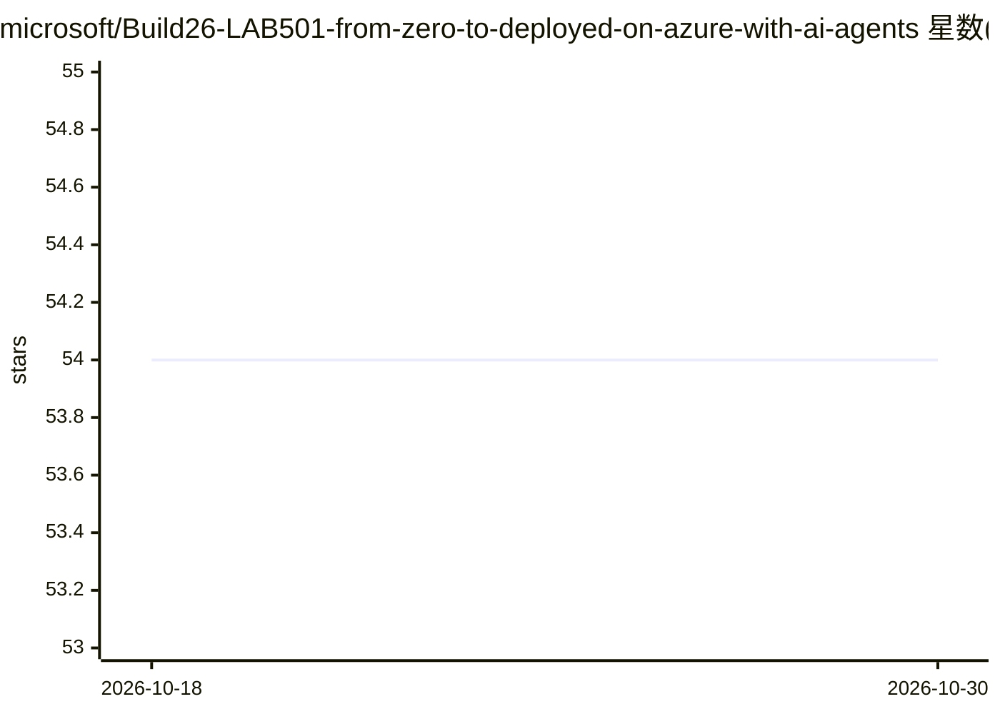

# microsoft/Build26-LAB501-from-zero-to-deployed-on-azure-with-ai-agents

⭐ 54 · HTML · MIT · 推送 2026-09-25 · [GitHub](https://github.com/microsoft/Build26-LAB501-from-zero-to-deployed-on-azure-with-ai-agents) · 组织维护

**Microsoft Build 2026 实验：用 Copilot CLI 与 Azure Skills 部署应用**

Microsoft Build 2026 的 75 分钟动手实验（LAB501）配套仓库，指导开发者从空终端出发，用 GitHub Copilot CLI 和 Azure Skills 插件通过自然语言完成 Flask 应用脚手架、Bicep IaC 生成、部署到 Azure Container Apps 与 Azure Function App，并演练托管身份加固、RBAC 最小权限、KQL 故障取证等架构审查场景。可在 Skillable 实验 VM 中跟做，也可自行 clone 仓库、自备 Azure 订阅与 Python 3.13+/Docker 等前置条件独立完成。

## 筛选速览

| 维度 | 判定 | 备注 |
|---|---|---|
| AI 角色 | `ai-knowledge` | 知识聚合/清单类 |
| 许可风险 | `permissive` | MIT |
| 部署形态 | `self-host` | docker 或自建部署 |
| 模型依赖 | — | README 未给出锁定关系 |
| 硬件要求 | — | 无带数字的原话,不猜 |
| 安装摩擦 | `low` | 无编译、无系统依赖或容器化 |
| 成熟度 | — | 结构信号不足 |

## 能力要点

- 用单个自然语言提示链式调用 azure-prepare/validate/deploy 技能完成部署
- 覆盖 AI 生成 Bicep/Dockerfile 的生产化审查与托管身份加固
- 含用 KQL 做 503 故障根因取证的运维场景
- 提供 Copilot Chat 后续探索提示词与 Microsoft Learn MCP Server 接入

## 适用场景

- 跟着实验学会用 Copilot CLI 自然语言驱动 Azure 部署
- 学习审查 AI 生成的 IaC 并做最小权限加固
- 练习不打开门户、用 KQL 排查线上问题

## 场景标签

`教程课程` `编码 Agent` · 领域:编码与开发

## 证据(README 行号)

> L16: What happens when you let AI agents do the building? In this hands-on lab, you'll go from an empty terminal to a de
> L18: Across 75 minutes (Level 300), you'll ship two services from a single Copilot prompt — a Python **Flask LEGO set br

## 星数曲线

2026-10-18 54 → 2026-10-30 54（+0）

---
*卡片 v1 · prompt 1.4 · 生成 2026-10-24 · 置信度 mid · 依据 README sha `b36fcdd3e75f` · [字段定义](../../DATASET.md)*
