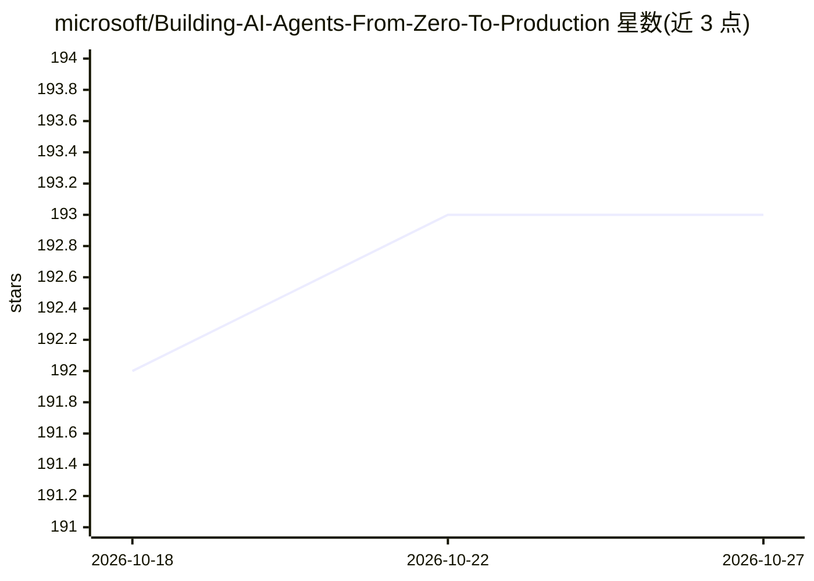

# microsoft/Building-AI-Agents-From-Zero-To-Production

⭐ 193 · Python · MIT · 推送 2026-10-22 · [GitHub](https://github.com/microsoft/Building-AI-Agents-From-Zero-To-Production) · 组织维护

**微软官方 AI Agent 开发生命周期教学课程**

面向学习者的 AI Agent 开发教学课程仓库：覆盖 Agent 设计、开发、评测、部署、生产级托管 Agent、Toolbox 与多 Agent/A2A 协议等 7 课，每课附可在本地运行的代码示例。技术栈基于 Microsoft Agent Framework、Microsoft Foundry（部署 GPT-5 系列模型）、Azure OpenAI Service 与 Azure CLI，需 Python 3.12+，实操会创建真实 Azure 资源并可能产生费用。通过 GitHub Action 提供 50+ 种语言翻译，可用 sparse checkout 克隆以减小下载体积。

## 筛选速览

| 维度 | 判定 | 备注 |
|---|---|---|
| AI 角色 | `ai-knowledge` | 知识聚合/清单类 |
| 许可风险 | `permissive` | MIT |
| 部署形态 | `None` |  |
| 模型依赖 | locked-api |  |
| 硬件要求 | — | 无带数字的原话,不猜 |
| 安装摩擦 | `low` | 无编译、无系统依赖或容器化 |
| 成熟度 | — | 结构信号不足 |

## 能力要点

- 7 课覆盖 Agent 设计/开发/评测/部署到生产的完整生命周期
- 基于 Microsoft Agent Framework 与 Microsoft Foundry（GPT-5 系列）
- 每课附可本地运行的代码示例
- GitHub Action 自动维护 50+ 种语言翻译

## 适用场景

- 系统学习 AI Agent 从零到生产的开发流程
- 跟随示例上手 Microsoft Agent Framework 与 Foundry
- 了解 A2A 协议、MCP Toolbox 等多 Agent 生产实践

## 场景标签

`教程课程` · 领域:学习与行业

## 证据(README 行号)

> L31: ## A course teaching you the fundamentals of the AI Agent Development Lifecycle
> L43: This course has lessons covering the fundamentals of building and deploying AI Agents.
> L88: |**Lesson**|**Description**|

## 星数曲线

2026-10-18 192 → 2026-10-27 193（+1）

---
*卡片 v1 · prompt 1.4 · 生成 2026-10-22 · 置信度 high · 依据 README sha `98e004aafa2f` · [字段定义](../../DATASET.md)*
