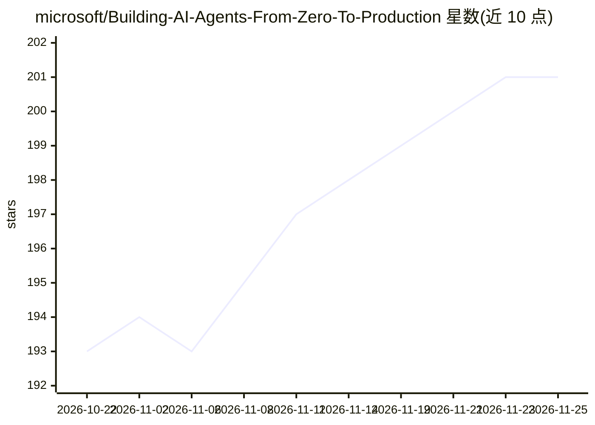

# microsoft/Building-AI-Agents-From-Zero-To-Production

⭐ 201 · Python · MIT · 推送 2026-10-30 · [GitHub](https://github.com/microsoft/Building-AI-Agents-From-Zero-To-Production) · 组织维护

**微软出品的 AI Agent 开发全周期教学课程**

由 Microsoft 团队维护的课程仓库，教授构建与部署 AI Agent 的基础知识，共 7 节递进式课程，涵盖 Agent 设计、开发、评估、部署、生产托管、工具箱治理及多 Agent/A2A 协议。每课附可本地运行的代码示例，基于 Microsoft Agent Framework（MAF）、Microsoft Foundry、Azure OpenAI Service、Azure CLI 与 Python 3.12+。提示用户注意 Azure 资源成本清理，提供 Discord 社区答疑与 50+ 语言翻译版本。

## 筛选速览

| 维度 | 判定 | 备注 |
|---|---|---|
| AI 角色 | `ai-knowledge` | 知识聚合/清单类 |
| 许可风险 | `permissive` | MIT |
| 部署形态 | `None` |  |
| 模型依赖 | locked-api |  |
| 硬件要求 | — | 无带数字的原话,不猜 |
| 安装摩擦 | `low` | 无编译、无系统依赖或容器化 |
| 成熟度 | — | 结构信号不足 |

## 能力要点

- 7 节递进式课程覆盖 AI Agent 全开发生命周期
- 每课附可本地运行的代码示例
- 50+ 语言翻译版本，支持稀疏克隆以减小下载体积
- 以『开发者入职』Agent 为统一贯穿用例

## 适用场景

- 系统学习从零到生产部署 AI Agent 的流程
- 了解 Microsoft Agent Framework 与 Foundry 的实际用法
- 学习多 Agent 编排与 A2A 协议实践

## 场景标签

`教程课程` · 领域:学习与行业

## 证据(README 行号)

> L31: ## A course teaching you the fundamentals of the AI Agent Development Lifecycle
> L43: This course has lessons covering the fundamentals of building and deploying AI Agents.
> L45: Each lesson builds on the previous one, so we recommend starting from the beginning and working your way through to

## 星数曲线

2026-10-22 193 → 2026-11-25 201（+8）

---
*卡片 v1 · prompt 1.4 · 生成 2026-11-25 · 置信度 high · 依据 README sha `1584d9fafbde` · [字段定义](../../DATASET.md)*
