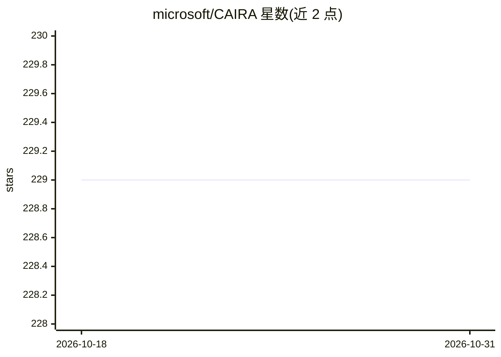

# microsoft/CAIRA

⭐ 229 · TypeScript · MIT · 推送 2026-09-22 · [GitHub](https://github.com/microsoft/CAIRA) · [官网](https://microsoft.github.io/CAIRA/) · 组织维护

**面向构建 Azure AI 方案的编码代理参考架构库**

微软维护的可组合 AI 参考架构库：面向用编码代理（如 Copilot CLI）搭建 Azure AI 解决方案的开发者。以 CAIRA skill 为入口，通过 bunx/npx skills 安装后，让编码代理检视仓库并仅复制/适配适配场景的参考组件。组件含 Foundry/Container Apps 的 Terraform、基于 OpenAI Agents SDK / Foundry Agent Service / Microsoft Agent Framework 的 API 参考及 React 前端；用 task 命令做组件本地化校验（npm/.NET/Terraform/Dockerfile）。

## 筛选速览

| 维度 | 判定 | 备注 |
|---|---|---|
| AI 角色 | `ai-knowledge` | 知识聚合/清单类 |
| 许可风险 | `permissive` | MIT |
| 部署形态 | `self-host` | docker 或自建部署 |
| 模型依赖 | locked-api |  |
| 硬件要求 | — | 无带数字的原话,不猜 |
| 安装摩擦 | `low` | 无编译、无系统依赖或容器化 |
| 成熟度 | — | 结构信号不足 |

## 能力要点

- 以 skill 形式供编码代理按需复制/适配参考组件
- 覆盖 Terraform 基础设施、TypeScript/C# 代理式 API、React 前端
- 组件本地化校验：npm 脚本、.NET 构建、Terraform fmt/init/validate、独立容器构建
- skill 测试经 GitHub Copilot CLI 无人值守模式运行 README 示例

## 适用场景

- 让我的编码代理快速搭建 Azure AI Foundry 方案骨架
- 查找 Terraform + 代理式 API + React 前端的可组合参考实现
- 为团队 Azure AI 项目提供经校验的起始模板

## 场景标签

`代码生成` · 领域:编码与开发

## 证据(README 行号)

> L3: CAIRA (Composable AI Reference Architectures) is a small reference library for agents building Azure AI solutions. T
> L5: Each directory under `reference-architectures/` is an independent reference component that should be easy to read, v

## 星数曲线

2026-10-18 229 → 2026-10-31 229（+0）

---
*卡片 v1 · prompt 1.4 · 生成 2026-10-22 · 置信度 mid · 依据 README sha `484f3df573d6` · [字段定义](../../DATASET.md)*
