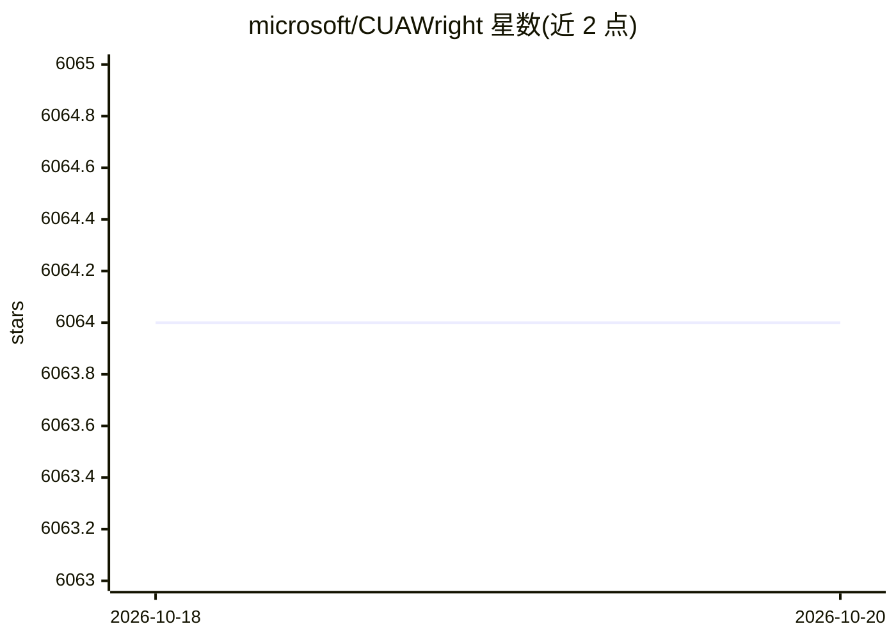

# microsoft/CUAWright

⭐ 6,064 · Python · MIT · 推送 2026-10-06 · [GitHub](https://github.com/microsoft/CUAWright) · 组织维护

**把编码模型变成浏览器/桌面自动化 agent 的最小框架**

微软开源的 SWE 风格 agent 框架，让编码模型通过终端编写并执行 Playwright 脚本来自动化浏览器，或在 Ubuntu VM（Docker + OSWorld-V2 任务集）中执行桌面任务。核心机制是把浏览器/桌面当作可启动、检查、丢弃的环境，以本地工作区（代码、截图、日志）作为持久状态；支持 OpenAI/Anthropic/OpenRouter 后端，提供 Skill Factory 将运行沉淀为可复用技能脚本。浏览器侧需 Python 3.10+ 与 Chromium，桌面侧需 Python 3.12+、Docker 及 Hugging Face gated 资产访问。

## 筛选速览

| 维度 | 判定 | 备注 |
|---|---|---|
| AI 角色 | `ai-ecosystem` | LLM/agent 周边工具 |
| 许可风险 | `permissive` | MIT |
| 部署形态 | `library` | 以包/库形式分发 |
| 模型依赖 | locked-api |  |
| 硬件要求 | — | 无带数字的原话,不猜 |
| 安装摩擦 | `low` | 无编译、无系统依赖或容器化 |
| 成熟度 | — | 结构信号不足 |

## 能力要点

- 代码即动作：模型自写 Playwright 脚本而非逐步点击
- 桌面任务在 Ubuntu VM 中运行，可复现 OSWorld-V2 基准
- Skill Factory 将每次求解沉淀为可独立复跑的参数化代码技能（零 token）
- Claude Code / Codex / Hermes 的浏览器插件/技能集成

## 适用场景

- 让编码模型自动化长程网页操作并生成可复用脚本
- 在 OSWorld-V2 环境中运行或复现桌面 agent 基准
- 给 Claude Code / Codex / Hermes 增加浏览器操作能力

## 场景标签

`Agent 框架` `浏览器自动化` `GUI 自动化` · 领域:Agent 开发

## 证据(README 行号)

> L20: CUAWright gives coding models a terminal to automate browsers and desktop applications.
> L54: - 🧩 **Pluggable model backends** — OpenAI, Anthropic, and OpenRouter, each ~150–200 lines.
> L170: `cuawright desktop` runs tasks in an OSWorld-V2 Ubuntu VM. The agent uses a

## 星数曲线

2026-10-18 6,064 → 2026-10-20 6,064（+0）

---
*卡片 v1 · prompt 1.4 · 生成 2026-10-20 · 置信度 high · 依据 README sha `b00adee07193` · [字段定义](../../DATASET.md)*
