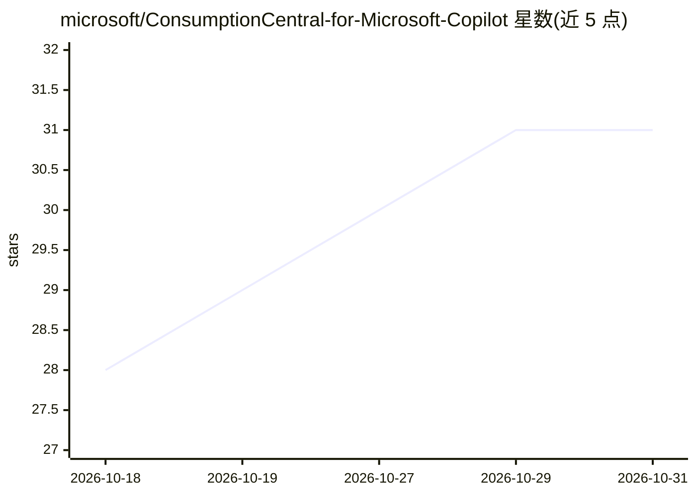

# microsoft/ConsumptionCentral-for-Microsoft-Copilot

⭐ 31 · TypeScript · MIT · 推送 2026-10-27 · [GitHub](https://github.com/microsoft/ConsumptionCentral-for-Microsoft-Copilot) · 组织维护

**Microsoft Copilot 额度消耗与成本分析的 Power BI 模板/应用**

由微软发布的消费分析工具：以 Power Apps 应用或 Power BI 报告两种形态，展示 Microsoft Copilot 生态的信用额度消耗、成本、节省与预测，覆盖 Cowork/Work IQ、Copilot Studio、GitHub Copilot 与 Azure AI Foundry 四个产品的导出数据，只需接入其一。提供浏览器内运行的安装器（Fabric 或 SharePoint+PAX 两条路线），支持每日自动刷新，另含离线示例数据的 HTML 演示与 Fabric App 部署方式。需管理员开启两项租户设置，使用者需 Power Apps Premium 或 Copilot Credits 许可。

## 筛选速览

| 维度 | 判定 | 备注 |
|---|---|---|
| AI 角色 | `ai-ecosystem` | LLM/agent 周边工具 |
| 许可风险 | `permissive` | MIT |
| 部署形态 | `library` | 以包/库形式分发 |
| 模型依赖 | — | README 未给出锁定关系 |
| 硬件要求 | — | 无带数字的原话,不猜 |
| 安装摩擦 | `low` | 无编译、无系统依赖或容器化 |
| 成熟度 | — | 结构信号不足 |

## 能力要点

- 覆盖四个 Copilot 产品的信用消耗、成本、节省与预测
- 浏览器内安装器支持 Fabric 与无 Fabric（SharePoint+PAX）两条路线，每日自动刷新
- 提供离线合成数据 HTML 演示，无需设置即可试用
- 支持 Fabric App 形态部署，实时读取已发布语义模型并应用行级安全

## 适用场景

- 企业内追踪 Copilot 各产品的信用额度消耗与成本
- 做 Copilot 支出的部门/按人分摊与预算预测
- 比较不同 Copilot 产品的使用情况，识别可削减的开支

## 场景标签

 · 领域:IT 成本管理/FinOps

## 证据(README 行号)

> L3: ### Microsoft Copilot credit consumption and cost, as an app or a Power BI report.
> L44: - **Four products:** Cowork / Work IQ, Copilot Studio, GitHub Copilot and Azure AI Foundry.

## 星数曲线

2026-10-18 28 → 2026-10-31 31（+3）

---
*卡片 v1 · prompt 1.4 · 生成 2026-10-26 · 置信度 high · 依据 README sha `085e97df5c72` · [字段定义](../../DATASET.md)*
