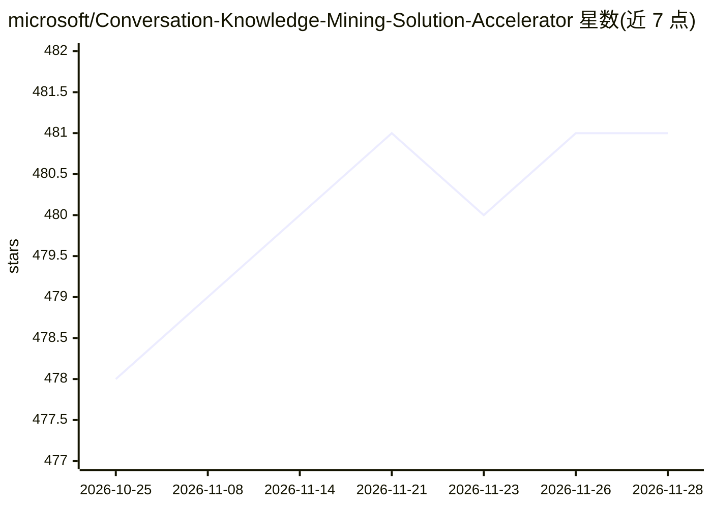

# microsoft/Conversation-Knowledge-Mining-Solution-Accelerator

⭐ 481 · Python · MIT · 推送 2026-11-27 · [GitHub](https://github.com/microsoft/Conversation-Knowledge-Mining-Solution-Accelerator) · 组织维护

**企业用生成式 AI 从对话数据中挖掘洞察的方案模板**

面向需要分析大量非结构化对话数据（通话记录、文档、音频）的组织：上传数据后经 Azure AI 提取流水线处理，生成实体/主题/关系知识库，提供三个界面——首页上传、与数据对话的 ChatAgent（路由到 AI Search 语义检索与 SQL 结构化分析两个工具）、由 LLM 读取数据 schema 自动规划 KPI 与图表的自适应仪表盘。部署依赖 Azure 订阅与 azd CLI（≥1.18.0），容器镜像在 Azure Container Registry 远程构建。

## 筛选速览

| 维度 | 判定 | 备注 |
|---|---|---|
| AI 角色 | `ai-native` | 本体是模型或模型工具 |
| 许可风险 | `permissive` | MIT |
| 部署形态 | `None` |  |
| 模型依赖 | locked-api |  |
| 硬件要求 | — | 无带数字的原话,不猜 |
| 安装摩擦 | `low` | 无编译、无系统依赖或容器化 |
| 成熟度 | — | 结构信号不足 |

## 能力要点

- ChatAgent 同时调用语义检索与 SQL 结构化分析回答数据问题
- LLM 读取数据 schema 自动规划 KPI 与图表的自适应仪表盘
- 支持 BYO Index/Data：连接既有 Azure AI Search 索引或 Fabric/SQL 数据源
- 内置三个示例场景包（IT 服务台、房贷申请、电信分析）

## 适用场景

- 对话务中心通话记录做情感分析与主题聚类
- 对购房报告与合同 PDF 做摘要与条款提取
- 让分析师用自然语言直接追问已有数据集

## 场景标签

`语义搜索` `文档问答` `数据分析` `文档解析` · 领域:效率与自动化

## 证据(README 行号)

> L3: Welcome to the *Conversation Knowledge Mining* solution accelerator, designed to help organizations derive actionabl
> L15: The solution leverages Microsoft Foundry, Azure Content Understanding, Azure OpenAI Service, Azure AI Search, Azure
> L26: - **Explore** — Converse with your data. Questions are routed to a Microsoft Foundry ChatAgent with two tools: Azur

## 星数曲线

2026-10-25 478 → 2026-11-28 481（+3）

---
*卡片 v1 · prompt 1.4 · 生成 2026-11-27 · 置信度 high · 依据 README sha `637976ea3275` · [字段定义](../../DATASET.md)*
