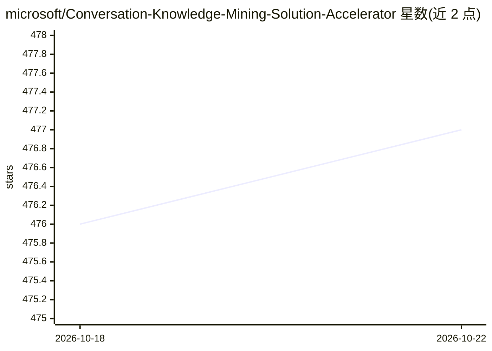

# microsoft/Conversation-Knowledge-Mining-Solution-Accelerator

⭐ 477 · Python · MIT · 推送 2026-10-21 · [GitHub](https://github.com/microsoft/Conversation-Knowledge-Mining-Solution-Accelerator) · 组织维护

**面向企业分析师的对话数据挖掘方案：提取洞察并支持自然语言交互探索**

微软出品的 Azure 解决方案加速器：用户上传或连接对话数据（PDF/DOCX/JSON/CSV/WAV 等），经 Azure Content Understanding 与 Azure OpenAI 的 AI 提取管道处理，生成嵌入并索引以支持 RAG 混合检索；随后通过 Microsoft Foundry 托管的 ChatAgent（工具为 Azure AI Search 语义检索与 SQL 结构化分析）进行自然语言问答，并由 LLM 根据数据模式自动规划 KPI 与图表生成自适应仪表盘。面向分析师与业务用户，需 Azure 订阅与 azd CLI 部署，含三个内置示例场景包与两种自带数据连接器（Azure AI Search 索引、Microsoft Fabric），各服务按用量计费。

## 筛选速览

| 维度 | 判定 | 备注 |
|---|---|---|
| AI 角色 | `ai-native` | 本体是模型或模型工具 |
| 许可风险 | `permissive` | MIT |
| 部署形态 | `None` |  |
| 模型依赖 | locked-api |  |
| 硬件要求 | — | 无带数字的原话,不猜 |
| 安装摩擦 | `low` | 无编译、无系统依赖或容器化 |
| 成熟度 | — | 结构信号不足 |

## 能力要点

- AI 提取管道从非结构化对话中抽取实体、主题与关系并生成嵌入索引
- Foundry ChatAgent 同时调用语义检索（Azure AI Search）与结构化分析（SQL）
- LLM 读取数据模式自动规划 KPI 与图表的自适应仪表盘
- 支持自带索引/数据（Azure AI Search、Microsoft Fabric），无需重新上传

## 适用场景

- 分析 IT 服务台通话记录的主题聚类、情感与坐席表现
- 对购房报告与合同 PDF 做摘要、条款抽取与风险分析
- 让业务人员用自然语言直接对话式查询已有数据

## 场景标签

`RAG` `数据分析` `文档解析` · 领域:效率与自动化

## 证据(README 行号)

> L7: The Conversation Knowledge Mining solution accelerator allows users to upload or connect data and have it automatica
> L15: The solution leverages Microsoft Foundry, Azure Content Understanding, Azure OpenAI Service, Azure AI Search, Azure
> L26: - **Explore** — Converse with your data. Questions are routed to a Microsoft Foundry ChatAgent with two tools: Azur

## 星数曲线

2026-10-18 476 → 2026-10-22 477（+1）

---
*卡片 v1 · prompt 1.4 · 生成 2026-10-21 · 置信度 high · 依据 README sha `d5903cec0f66` · [字段定义](../../DATASET.md)*
