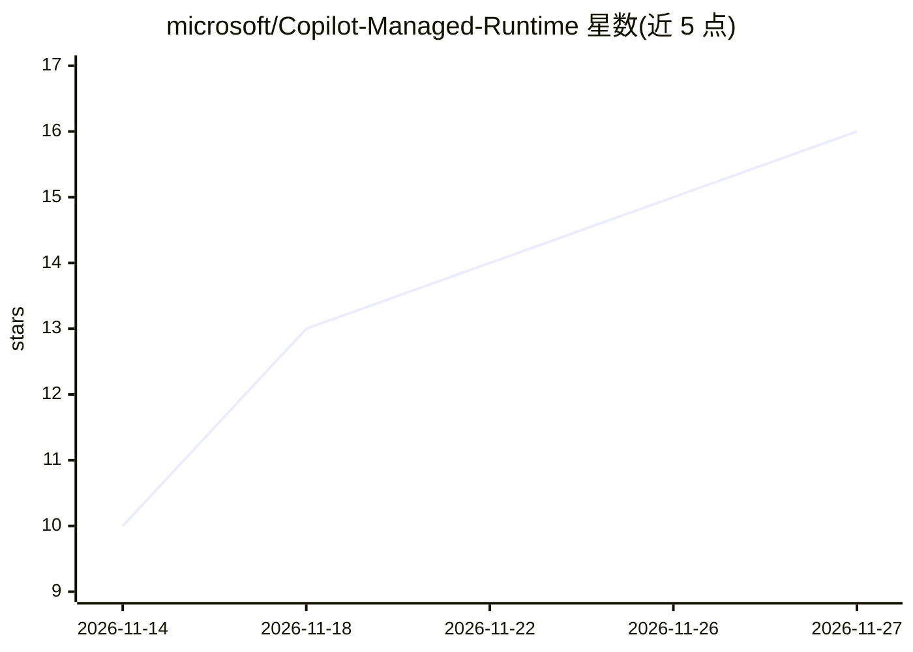

# microsoft/Copilot-Managed-Runtime

⭐ 16 · TypeScript · MIT · 推送 2026-11-20 · [GitHub](https://github.com/microsoft/Copilot-Managed-Runtime) · 组织维护

**为 Copilot Managed Runtime 应用提供模板与编码代理插件**

微软官方仓库，托管 Copilot Managed Runtime 应用开发的第一方项目模板与公开 issue 跟踪；工具本身以 @microsoft 作用域的 npm 包发布，包括应用 SDK、CLI 与 Vite 插件。仓库含 React + TypeScript + Vite 8 起始模板、可本地部署的示例应用（默认浏览器存储，可迁移至 SharePoint/Dataverse/自建 API），以及供 AI 编码代理（Claude Code、GitHub Copilot）使用的 skills/agents/hooks 插件，通过 marketplace manifest 安装。

## 筛选速览

| 维度 | 判定 | 备注 |
|---|---|---|
| AI 角色 | `ai-ecosystem` | LLM/agent 周边工具 |
| 许可风险 | `permissive` | MIT |
| 部署形态 | `None` |  |
| 模型依赖 | — | README 未给出锁定关系 |
| 硬件要求 | — | 无带数字的原话,不猜 |
| 安装摩擦 | `low` | 无编译、无系统依赖或容器化 |
| 成熟度 | — | 结构信号不足 |

## 能力要点

- 提供 @microsoft/cmr-apps SDK、cmr-cli 与 Vite 插件三个 npm 包
- vite8（React + TypeScript + Vite 8）第一方项目模板
- 面向 Claude Code 与 GitHub Copilot 的编码代理插件（skills/agents/hooks）
- 示例应用支持将浏览器本地数据迁移至 SharePoint/Dataverse/自建 API

## 适用场景

- 为 Microsoft 365 业务应用搭建托管运行时项目脚手架
- 用 CLI 初始化和管理托管应用仓库
- 让 AI 编码代理加载插件协助构建托管应用

## 场景标签

`代码生成` · 领域:编码与开发

## 证据(README 行号)

> L5: This repository hosts the official first-party project **templates** and is the home for **public issues**. The tool
> L21: - `plugins/` — the `copilot-managed-runtime` plugin: skills, agents, and hooks for building apps hosted on Copilot 

## 星数曲线

2026-11-14 10 → 2026-11-27 16（+6）

---
*卡片 v1 · prompt 1.4 · 生成 2026-11-18 · 置信度 high · 依据 README sha `98cd98ee8ee2` · [字段定义](../../DATASET.md)*
