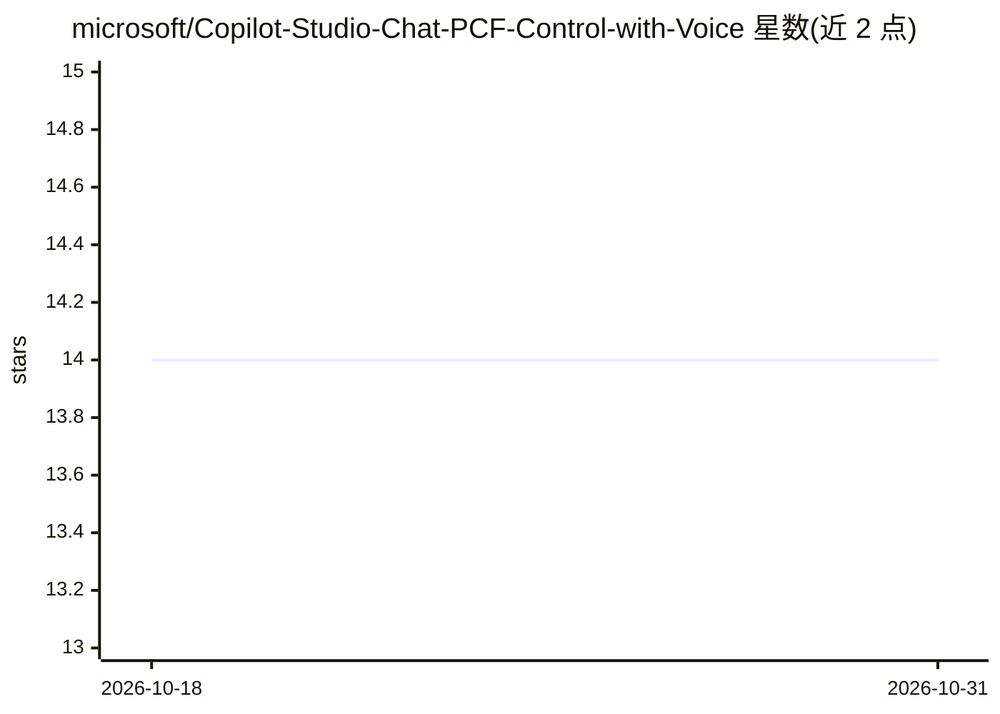

# microsoft/Copilot-Studio-Chat-PCF-Control-with-Voice

⭐ 14 · TypeScript · MIT · 推送 2026-06-30 · [GitHub](https://github.com/microsoft/Copilot-Studio-Chat-PCF-Control-with-Voice) · 组织维护

**在 Power Apps 中嵌入 Copilot Studio 对话的 PCF 控件，支持语音**

面向 Power Apps 制作者的 Power Apps Component Framework（PCF）控件：通过 Direct Line API 连接 Microsoft Copilot Studio 机器人，在画布应用内呈现聊天界面，支持语音输入（浏览器 Web Speech API 或 Azure Speech）、语音输出（Azure Neural Voices 或 OpenAI TTS）、自适应卡片、34 种语言（Beta）与免提驾驶模式（Beta）。构建需 Power Platform CLI、Node.js v16+ 与 .NET Framework 4.8.1；仓库声明仅用于演示与教育，非官方支持产品。

## 筛选速览

| 维度 | 判定 | 备注 |
|---|---|---|
| AI 角色 | `ai-ecosystem` | LLM/agent 周边工具 |
| 许可风险 | `permissive` | MIT |
| 部署形态 | `library` | 以包/库形式分发 |
| 模型依赖 | locked-api |  |
| 硬件要求 | — | 无带数字的原话,不猜 |
| 安装摩擦 | `low` | 无编译、无系统依赖或容器化 |
| 成熟度 | — | 结构信号不足 |

## 能力要点

- 通过 Direct Line API 连接 Copilot Studio 机器人
- 语音输入（Web Speech API/Azure Speech）与语音输出（Azure Neural/OpenAI TTS）
- 自适应卡片渲染与 34 种语言支持（Beta）
- 提供一键部署 Azure Speech 与 Azure OpenAI 资源模板

## 适用场景

- 在画布应用中嵌入 Copilot Studio 客服/助理机器人
- 为一线外勤人员提供免提语音交互（驾驶模式）
- 多语言语音问答场景部署

## 场景标签

`聊天机器人` `语音 Agent` · 领域:对话与助手

## 证据(README 行号)

> L8: A Power Apps Component Framework (PCF) control that enables rich chat experiences with Microsoft Copilot Studio, fea
> L17: - ✅ **Direct Line Integration** - Connects to Copilot Studio via Direct Line API

## 星数曲线

2026-10-18 14 → 2026-10-31 14（+0）

---
*卡片 v1 · prompt 1.4 · 生成 2026-10-31 · 置信度 mid · 依据 README sha `93171cd2e786` · [字段定义](../../DATASET.md)*
