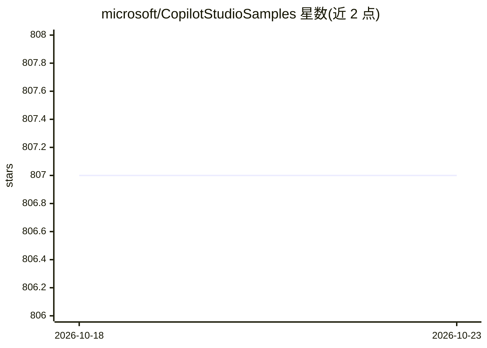

# microsoft/CopilotStudioSamples

⭐ 807 · TypeScript · MIT · 推送 2026-10-21 · [GitHub](https://github.com/microsoft/CopilotStudioSamples) · 组织维护

**微软 Copilot Studio 官方示例与制品合集**

微软维护的 Microsoft Copilot Studio 样例仓库，按类别组织可导入内容与代码：authoring 目录提供 PnP 格式可导入解决方案与话题/Adaptive Cards 片段，extensibility 目录含 MCP 服务器、A2A 协议与 M365 Agents SDK 示例，另有联系中心集成、SSO（Entra ID/Okta）、部署模板与 VNet 配置、pytest/JMeter 测试及自定义聊天 UI 等示例。旧版 Power Virtual Agents 样例移至 Legacy 分支；EmployeeSelfServiceAgent 目录标注待弃用。面向在 Copilot Studio 上构建 agent 的开发者。

## 筛选速览

| 维度 | 判定 | 备注 |
|---|---|---|
| AI 角色 | `ai-knowledge` | 知识聚合/清单类 |
| 许可风险 | `permissive` | MIT |
| 部署形态 | `None` |  |
| 模型依赖 | — | README 未给出锁定关系 |
| 硬件要求 | — | 无带数字的原话,不猜 |
| 安装摩擦 | `medium` | 含编译或系统依赖之一 |
| 成熟度 | — | 结构信号不足 |

## 能力要点

- authoring/ 提供可导入的 PnP 格式解决方案与复制粘贴片段
- extensibility/ 含 MCP 服务器、A2A 协议与 M365 Agents SDK 示例
- 覆盖 SSO（Entra ID/Okta）、部署模板、VNet 配置与测试示例
- 联系中心集成与人工坐席转接示例

## 适用场景

- 为 Copilot Studio 构建话题与 Adaptive Cards
- 将 copilot 扩展为 MCP 服务器或对接 M365 Agents SDK
- 参考部署模板与 VNet 配置上线 agent
- 实现 ServiceNow/Power Apps 等平台内嵌聊天 UI

## 场景标签

`Agent 框架` `教程课程` · 领域:Agent 开发

## 证据(README 行号)

> L9: This repository contains samples and artifacts for Microsoft Copilot Studio.
> L44: |extensibility/|MCP servers, A2A protocol, and M365 Agents SDK samples|

## 星数曲线

2026-10-18 807 → 2026-10-23 807（+0）

---
*卡片 v1 · prompt 1.4 · 生成 2026-10-21 · 置信度 high · 依据 README sha `c11f4a886b2a` · [字段定义](../../DATASET.md)*
