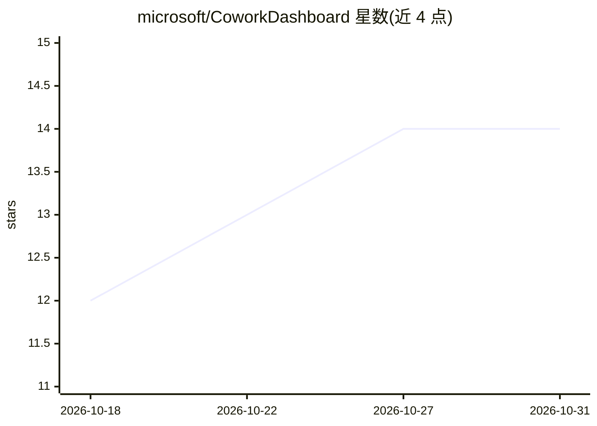

# microsoft/CoworkDashboard

⭐ 14 · Python · MIT · 推送 2026-10-27 · [GitHub](https://github.com/microsoft/CoworkDashboard) · [官网](https://aka.ms/CoworkDashboard) · 组织维护

**Copilot Cowork 技能对：把团队省时数据汇成匿名 ROI 报表**

由 Microsoft 组织发布的两个 Copilot Cowork 技能（team-member 技能与 manager 技能），通过一个启用了邮件的 Teams 频道协同：成员技能将个人 Copilot 使用情况生成去标识摘要（省时小时数、价值、工作类型与产出）并邮件到频道，发送前成员可剔除会话；manager 技能读取频道汇总为自包含的匿名 HTML 仪表盘，邮件发送需确认与批准。配套 Installer Studio 网页在浏览器本地生成预填频道信息的技能 zip。声明非官方 Cowork 技能，可自行定制。

## 筛选速览

| 维度 | 判定 | 备注 |
|---|---|---|
| AI 角色 | `ai-enhanced` | 去掉 AI 部分产品仍成立 |
| 许可风险 | `permissive` | MIT |
| 部署形态 | `desktop` | 安装包/桌面程序 |
| 模型依赖 | — | README 未给出锁定关系 |
| 硬件要求 | — | 无带数字的原话,不猜 |
| 安装摩擦 | `low` | 无编译、无系统依赖或容器化 |
| 成熟度 | — | 结构信号不足 |

## 能力要点

- 成员技能产出去标识摘要：省时小时数、时间价值、工作类型与产出
- 发送前强制隐私审查，成员可剔除会话且剔除项不参与计算
- manager 技能生成自包含匿名 HTML 仪表盘，无需服务器
- Installer Studio 在浏览器本地构建安装包，频道信息不上传服务器

## 适用场景

- 团队负责人查看 Copilot 使用带来的省时与价值汇总
- 以匿名、可审查方式收集成员的 Copilot 使用报表
- 通过 Teams 频道邮件通道自动汇总并定期生成团队报告

## 场景标签

`数据分析` · 领域:效率与自动化

## 证据(README 行号)

> L6: **Cowork Team Report** is a two-part Microsoft Copilot **Cowork** solution that shows a team the **ROI**
> L18: - **Cowork Team Report — Team Dashboard skill** (the manager skill). The manager/lead runs it. It reads the shared
> L107: The manager skill builds **`output/team-dashboard/team-dashboard-report.html`**, a self-contained

## 星数曲线

2026-10-18 12 → 2026-10-31 14（+2）

---
*卡片 v1 · prompt 1.4 · 生成 2026-10-31 · 置信度 high · 依据 README sha `2fe5678d22a6` · [字段定义](../../DATASET.md)*
