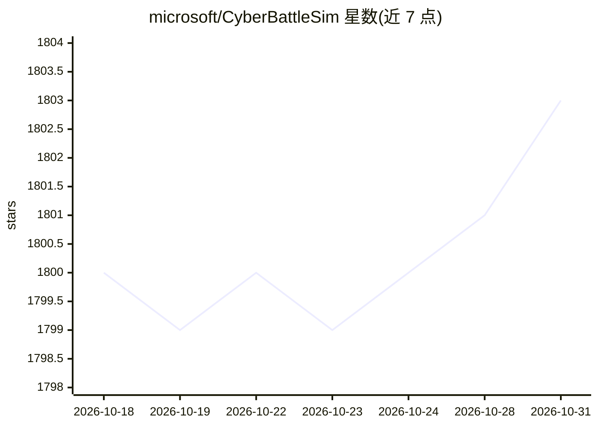

# microsoft/CyberBattleSim

⭐ 1,803 · Jupyter Notebook · MIT · 推送 2026-10-30 · [GitHub](https://github.com/microsoft/CyberBattleSim) · 组织维护

**微软的网络安全强化学习实验仿真平台**

由微软 Defender Research 团队维护的实验研究平台：在抽象化的企业网络仿真环境中运行自动化攻击者与防御者智能体，攻击者利用植入节点的漏洞横向移动以夺取网络所有权，防御者基于随机概率模型检测攻击并通过重装节点缓解影响。提供 Python OpenAI Gym 接口，支持用强化学习算法训练智能体，附 DQL 等基线智能体与基准评测 Notebook。仿真高度抽象，官方声明不可直接用于真实系统；建议 Linux/WSL 环境，Docker 镜像需自行构建。

## 筛选速览

| 维度 | 判定 | 备注 |
|---|---|---|
| AI 角色 | `ai-ecosystem` | LLM/agent 周边工具 |
| 许可风险 | `permissive` | MIT |
| 部署形态 | `desktop` | 安装包/桌面程序 |
| 模型依赖 | — | README 未给出锁定关系 |
| 硬件要求 | — | 无带数字的原话,不猜 |
| 安装摩擦 | `low` | 无编译、无系统依赖或容器化 |
| 成熟度 | — | 结构信号不足 |

## 能力要点

- Open AI Gym 接口的企业网络攻防仿真环境
- 攻击者/防御者双向智能体建模，含随机概率检测与重装缓解机制
- 提供基线 RL 智能体（DQL、Q-Learning 等）与基准评测 Notebook
- 支持自定义网络拓扑与漏洞集注册 Gym 环境

## 适用场景

- 研究自动化网络攻防智能体在抽象网络中的交互
- 对强化学习算法在网络安全场景下做基准评测
- 研究网络拓扑与配置对横向移动攻击的影响

## 场景标签

`网络安全` `强化学习` · 领域:学习与行业

## 证据(README 行号)

> L5: CyberBattleSim is an experimentation research platform to investigate the interaction
> L9: Its Python-based Open AI Gym interface allows for the training of

## 星数曲线

2026-10-18 1,800 → 2026-10-31 1,803（+3）

---
*卡片 v1 · prompt 1.4 · 生成 2026-10-21 · 置信度 high · 依据 README sha `aa8a9de985b9` · [字段定义](../../DATASET.md)*
