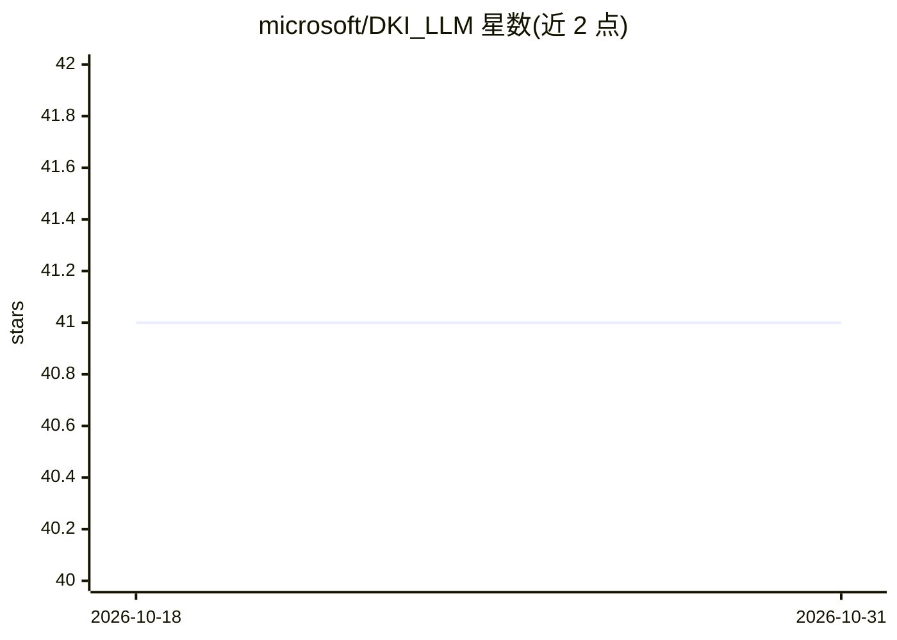

# microsoft/DKI_LLM

⭐ 41 · Python · MIT · 推送 2026-05-20 · [GitHub](https://github.com/microsoft/DKI_LLM) · 组织维护

**微软 DKI 组 LLM 论文与对应代码的汇总仓库**

微软 DKI LLM 组的论文代码合集：按 Deep Research、强化学习、代码生成、广告推荐四个方向组织，收录多篇发表于 ICML/ICLR/ACL/KDD 的论文，点击标题可定位对应开源代码。内容涵盖深度研究知识探索、LLM 奖励学习、文生图强化学习重提示、端到端微服务生成基准与用户画像生成等，MIT 许可，通过 issue 与邮件提供联系方式。

## 筛选速览

| 维度 | 判定 | 备注 |
|---|---|---|
| AI 角色 | `ai-knowledge` | 知识聚合/清单类 |
| 许可风险 | `permissive` | MIT |
| 部署形态 | `None` |  |
| 模型依赖 | — | README 未给出锁定关系 |
| 硬件要求 | — | 无带数字的原话,不猜 |
| 安装摩擦 | `low` | 无编译、无系统依赖或容器化 |
| 成熟度 | — | 结构信号不足 |

## 能力要点

- 收录多篇 ICML/ICLR/ACL/KDD 论文及对应代码入口
- 按 Deep Research / RL / Code Gen / Ads 四类组织
- 微软 DKI LLM 组维护，MIT 许可

## 适用场景

- 查找 LLM 相关论文的开源实现
- 跟踪微软 DKI 组研究进展与代码发布

## 场景标签

`精选清单` · 领域:学习与行业

## 证据(README 行号)

> L5: This repo hosts multiple open-source codes of the Microsoft DKI LLM Group. You could find the corresponding code as 
> L13: ## Code Release (Click Title to Locate the Code)

## 星数曲线

2026-10-18 41 → 2026-10-31 41（+0）

---
*卡片 v1 · prompt 1.4 · 生成 2026-10-25 · 置信度 high · 依据 README sha `9ab3690788f7` · [字段定义](../../DATASET.md)*
