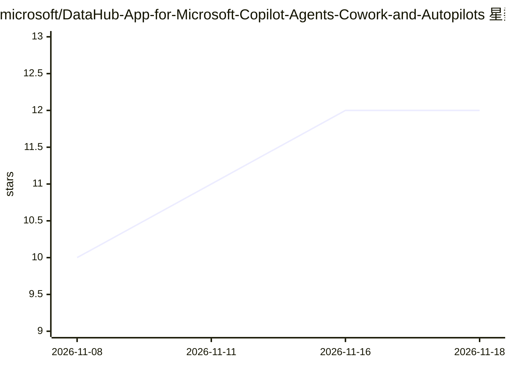

# microsoft/DataHub-App-for-Microsoft-Copilot-Agents-Cowork-and-Autopilots

⭐ 12 · JavaScript · MIT · 推送 2026-11-16 · [GitHub](https://github.com/microsoft/DataHub-App-for-Microsoft-Copilot-Agents-Cowork-and-Autopilots) · 组织维护

**分析组织内 Microsoft 365 Copilot 与 agent 使用量及价值估算的报表应用**

面向 Microsoft 365 租户的分析工具：从 Purview 审计日志等来源抽取数据，存入用户自己的 Fabric 工作区或 Azure 订阅，生成 Power BI 报表，展示 Copilot、agent 与 Cowork 的使用情况、估算节省工时与成本，数据每日自动刷新。提供约 20 分钟的安装器（PowerShell/exe）和逐步手动部署两条路径。前置条件包括 Fabric 容量或 Azure 订阅、Power BI Pro、Entra 应用注册权限。README 明确说明其数字来自非权威来源，可能与官方报表不一致，且为实验性项目，不经 Microsoft 支持渠道。

## 筛选速览

| 维度 | 判定 | 备注 |
|---|---|---|
| AI 角色 | `ai-enhanced` | 去掉 AI 部分产品仍成立 |
| 许可风险 | `permissive` | MIT |
| 部署形态 | `None` |  |
| 模型依赖 | — | README 未给出锁定关系 |
| 硬件要求 | — | 无带数字的原话,不猜 |
| 安装摩擦 | `low` | 无编译、无系统依赖或容器化 |
| 成熟度 | — | 结构信号不足 |

## 能力要点

- 从 Purview 审计日志抽取 Copilot/agent 使用数据，保留在用户自有租户
- Power BI 报表展示使用量、估算节省工时与成本，数据每日自动刷新
- 提供 PowerShell 安装器与手动部署两条路径
- 免费工具，用户只需为 Fabric 容量或 Azure 资源付费

## 适用场景

- 企业 IT 部门跟踪组织内 Microsoft 365 Copilot 与 agent 的采纳情况
- 估算 Copilot 使用带来的工时节省与成本价值
- 分析 Cowork 就绪度与积分消耗

## 场景标签

`数据分析` · 领域:效率与自动化

## 证据(README 行号)

> L3: **See how your organisation uses Microsoft 365 Copilot, agents and Cowork, and their estimated hours saved and value
> L36: - An app and Power BI reports on Copilot, agent and Cowork use, estimated value and cost.
> L116:  The DataHub App takes its Copilot figures mainly from the Purview audit log, which isn't the

## 星数曲线

2026-11-08 10 → 2026-11-18 12（+2）

---
*卡片 v1 · prompt 1.4 · 生成 2026-11-18 · 置信度 high · 依据 README sha `cf80e9e05e67` · [字段定义](../../DATASET.md)*
