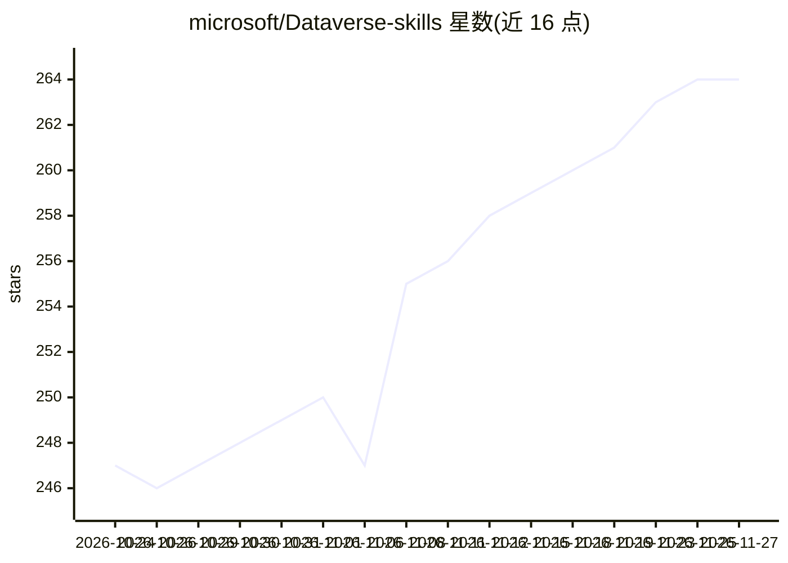

# microsoft/Dataverse-skills

⭐ 264 · MIT · 推送 2026-11-21 · [GitHub](https://github.com/microsoft/Dataverse-skills) · 组织维护

**让 AI 编码代理用自然语言构建、查询与管理 Dataverse 环境的技能集**

微软官方发布的 agent skills 插件，将 Dataverse MCP 服务器、Dataverse CLI、Python SDK 与 PAC CLI 封装为多个专项技能，覆盖数据模型编写、记录查询与 CRUD、解决方案生命周期、Finance and Operations X++ 开发部署、环境管理与安全角色配置等。通过 dv-connect 完成认证与 MCP 注册，采用最小权限模型，凭证存于操作系统原生凭据库。需已具备 Dataverse 环境（含免费 Power Apps Developer Plan）。

## 筛选速览

| 维度 | 判定 | 备注 |
|---|---|---|
| AI 角色 | `ai-ecosystem` | LLM/agent 周边工具 |
| 许可风险 | `permissive` | MIT |
| 部署形态 | `library` | 以包/库形式分发 |
| 模型依赖 | — | README 未给出锁定关系 |
| 硬件要求 | — | 无带数字的原话,不猜 |
| 安装摩擦 | `low` | 无编译、无系统依赖或容器化 |
| 成熟度 | — | 结构信号不足 |

## 能力要点

- 9 个专项技能覆盖查询、数据、元数据、解决方案、X++、SQL 只读访问、管理与安全
- 支持 GitHub Copilot、Claude Code、Cursor、Codex、Gemini CLI、JetBrains 等多种代理安装方式
- 最小权限安全模型：MCP 授权、服务端角色强制、OS 原生凭据存储
- dv-query 支持 pandas DataFrame 加载用于 notebook 分析

## 适用场景

- 用自然语言查询和导入 Dataverse 业务数据
- 为 CRM 应用创建数据模型并打包部署解决方案
- 编写、编译并部署 Finance and Operations X++ 包
- 批量执行环境管理与安全角色配置任务

## 场景标签

`编码 Agent` · 领域:编码与开发

## 证据(README 行号)

> L5: Build, query, and manage Microsoft Dataverse and linked Dynamics 365 Finance and Operations environments through nat
> L44: This works with any agent that reads local skills. JetBrains IDEs also have a native listing -- see JetBrains IDEs.

## 星数曲线

2026-10-24 247 → 2026-11-27 264（+17）

---
*卡片 v1 · prompt 1.4 · 生成 2026-11-25 · 置信度 high · 依据 README sha `004e67a8608b` · [字段定义](../../DATASET.md)*
