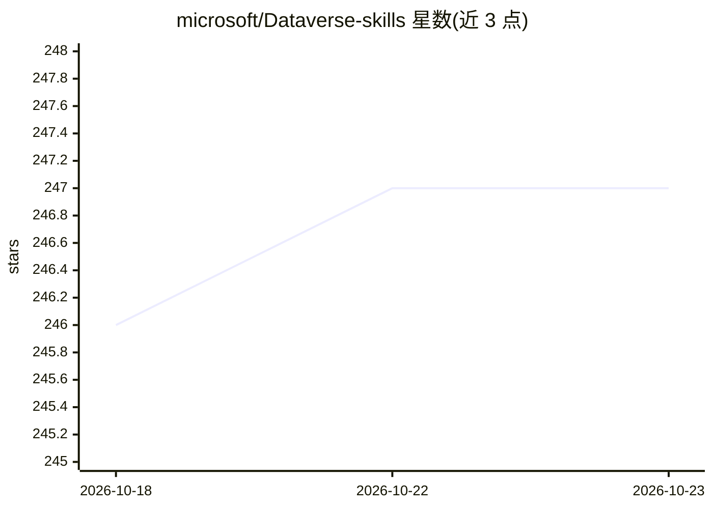

# microsoft/Dataverse-skills

⭐ 247 · MIT · 推送 2026-10-20 · [GitHub](https://github.com/microsoft/Dataverse-skills) · 组织维护

**教 AI 编程代理操作 Microsoft Dataverse 的技能插件**

Microsoft 维护的 agent 技能插件，将 Dataverse MCP 服务器、Dataverse CLI、Python SDK 与 PAC CLI 封装为 9 个专门技能（dv-connect/dv-query/dv-data/dv-metadata/dv-solution/erp-xpp/dv-admin/dv-security/dv-overview），供 AI 编程代理用自然语言完成 Dataverse 与 Dynamics 365 Finance and Operations 环境的建模、查询、CRUD、方案生命周期、X++ 编译部署与安全管理。通过 npx 一键安装到 Codex、Copilot、Claude Code、Cursor、Gemini CLI 等代理。前提是需有 Dataverse 环境（含免费 Power Apps 开发者计划）。采用最小权限模型，权限不超出认证用户范围。

## 筛选速览

| 维度 | 判定 | 备注 |
|---|---|---|
| AI 角色 | `ai-ecosystem` | LLM/agent 周边工具 |
| 许可风险 | `permissive` | MIT |
| 部署形态 | `library` | 以包/库形式分发 |
| 模型依赖 | — | README 未给出锁定关系 |
| 硬件要求 | — | 无带数字的原话,不猜 |
| 安装摩擦 | `low` | 无编译、无系统依赖或容器化 |
| 成熟度 | — | 结构信号不足 |

## 能力要点

- 9 个技能覆盖查询、CRUD、元数据、方案部署、X++ 生命周期、管理与安全
- 一条 npx 命令安装并选择目标代理（Codex/Copilot/Claude Code/Cursor 等）
- 跨 MCP 服务器、Dataverse CLI、Python SDK、PAC CLI 四种工具的自动路由
- 最小权限安全模型：MCP 需开发者认证与租户管理员同意，凭据存 OS 原生凭据库

## 适用场景

- 让 AI 编程代理直接查询和导入我的 Dataverse CRM 数据
- 通过对话设计数据模型并打包部署 Dataverse 方案
- 管理 Dynamics 365 F&O 的 X++ 模型编译与部署包
- 让代理执行 Dataverse 环境的批量清理与安全角色分配

## 场景标签

 · 领域:企业应用开发/Microsoft Power Platform

## 证据(README 行号)

> L5: Build, query, and manage Microsoft Dataverse and linked Dynamics 365 Finance and Operations environments through nat
> L9: |**dv-connect**|One-time setup that installs the Dataverse CLI, Python SDK, and PAC CLI; authenticates against your 

## 星数曲线

2026-10-18 246 → 2026-10-23 247（+1）

---
*卡片 v1 · prompt 1.4 · 生成 2026-10-22 · 置信度 high · 依据 README sha `456862102ee3` · [字段定义](../../DATASET.md)*
