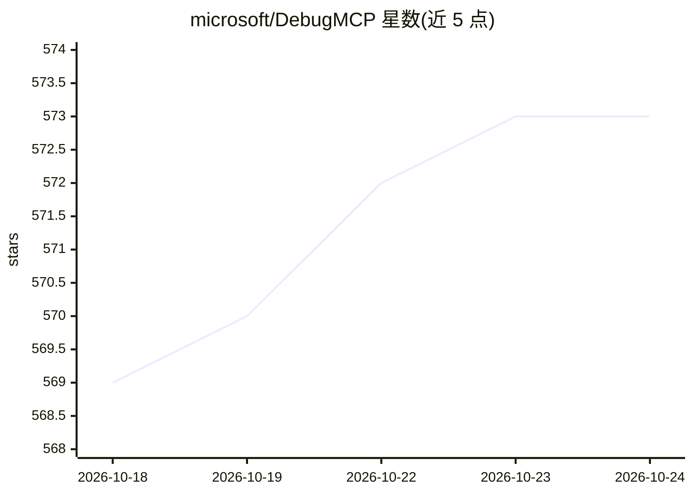

# microsoft/DebugMCP

⭐ 573 · TypeScript · MIT · 推送 2026-10-21 · [GitHub](https://github.com/microsoft/DebugMCP) · 组织维护

**让 AI 编程代理在 VS Code 中操作调试器的 MCP 服务器**

微软开发者维护的 MCP 服务器，以 VS Code 扩展与独立 CLI（npm 发布，preview）两种形式提供，使 MCP 兼容的 AI 编程代理（GitHub Copilot、Claude Code、Cursor、Codex 等）能自主设置断点、启动调试会话、逐步执行、检查变量与求值表达式。CLI 版本不经 VS Code，直接对接显式配置的 DAP 适配器（stdio），支持 python/java/cpp/go/rust 等语言缩写。服务器 100% 本地运行，无需凭据；扩展模式下各语言需对应的 VS Code 调试扩展，CLI 模式需自行安装各语言的 DAP 适配器。

## 筛选速览

| 维度 | 判定 | 备注 |
|---|---|---|
| AI 角色 | `ai-ecosystem` | LLM/agent 周边工具 |
| 许可风险 | `permissive` | MIT |
| 部署形态 | `library` | 以包/库形式分发 |
| 模型依赖 | locked-api |  |
| 硬件要求 | — | 无带数字的原话,不猜 |
| 安装摩擦 | `medium` | 含编译或系统依赖之一 |
| 成熟度 | `idea` | |

## 能力要点

- 16 个调试工具：断点/日志点、逐步执行、暂停、变量检查、表达式求值
- 独立 CLI 可脱离 VS Code 通过 stdio 对接显式配置的 DAP 适配器
- 自动注册到 GitHub Copilot、Claude Code、Cursor 等 9 种助手及任意 MCP 兼容代理
- 附带跨代理安装的 debug-live 系统化调试技能（Agent Skill）

## 适用场景

- 让 AI 编程助手代替我设置断点、单步执行并分析代码
- 在无 IDE 的终端环境中用 AI agent 调试 Python/Java/Go 等程序
- 通过 VS Code Testing API 在单个测试用例内获得一致的断点命中

## 场景标签

`编码 Agent` · 领域:编码与开发

## 证据(README 行号)

> L53: DebugMCP is an MCP server that gives AI coding agents full control over the VS Code debugger. Instead of reading lo
> L198: DebugMCP works with any MCP-compatible AI assistant. It auto-detects and offers to register itself with:

## 星数曲线

2026-10-18 569 → 2026-10-24 573（+4）

---
*卡片 v1 · prompt 1.4 · 生成 2026-10-21 · 置信度 high · 依据 README sha `b84c9caf512e` · [字段定义](../../DATASET.md)*
