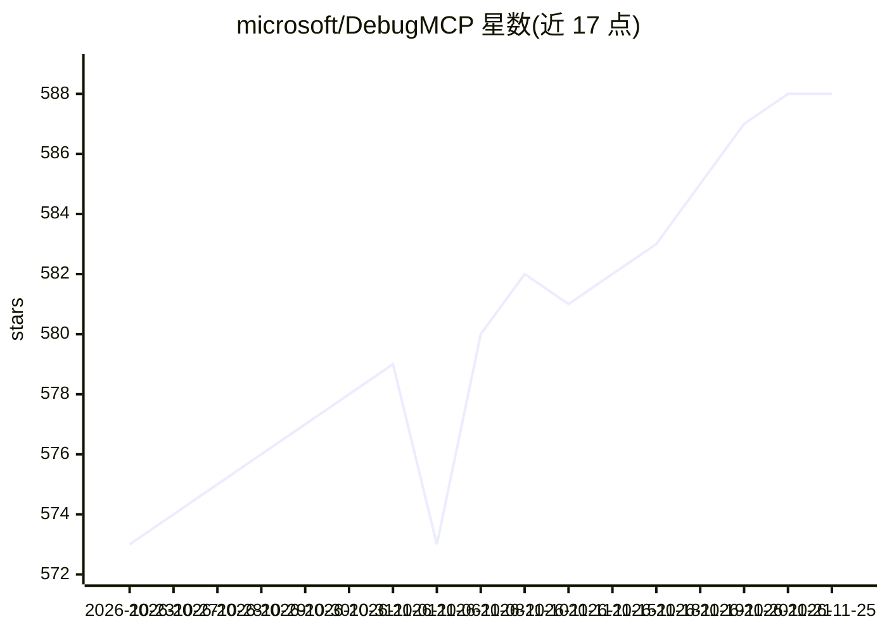

# microsoft/DebugMCP

⭐ 588 · TypeScript · MIT · 推送 2026-11-13 · [GitHub](https://github.com/microsoft/DebugMCP) · 组织维护

**给 VS Code 内 AI 编码代理接入真实调试能力的 MCP 服务器**

DebugMCP 是一个 MCP 服务器，把 VS Code 调试器的能力暴露给 AI 编码代理：代理可自主启动调试会话、设置断点与日志点、单步执行、暂停运行中的程序、读取变量值与求值表达式。提供 17 个调试工具与配套的 debug-live 工作流技能，支持任何 MCP 兼容助手，覆盖 VS Code 支持的全部语言。运行 100% 本地、无凭据要求；另有不依赖 IDE 的独立 CLI 版本，通过显式注册 DAP 适配器工作。

## 筛选速览

| 维度 | 判定 | 备注 |
|---|---|---|
| AI 角色 | `ai-ecosystem` | LLM/agent 周边工具 |
| 许可风险 | `permissive` | MIT |
| 部署形态 | `library` | 以包/库形式分发 |
| 模型依赖 | — | README 未给出锁定关系 |
| 硬件要求 | — | 无带数字的原话,不猜 |
| 安装摩擦 | `medium` | 含编译或系统依赖之一 |
| 成熟度 | — | 结构信号不足 |

## 能力要点

- 17 个调试工具：断点/日志点、单步、暂停运行中程序、变量读取与表达式求值
- 独立 CLI 版本无需 VS Code，直连显式配置的 DAP 适配器
- debug-live 系统化调试工作流以 Agent Skill 形式装入标准技能目录
- 基于 VS Code Testing API 的测试级断点命中，覆盖 pytest/Jest/.NET/Go 等运行器

## 适用场景

- 让 AI 代理在 VS Code 中自主打断点、单步并检查变量来定位 bug
- 在无 IDE 的终端环境中让代理连接 DAP 适配器调试程序
- 让代理发现并启动单个测试用例并命中内部断点

## 场景标签

`编码 Agent` · 领域:编码与开发

## 证据(README 行号)

> L1: # DebugMCP (MCP Server) - Empowering AI Agents with Operational Debugging Capabilities
> L53: DebugMCP is an MCP server that gives AI coding agents full control over the VS Code debugger. Instead of reading lo

## 星数曲线

2026-10-23 573 → 2026-11-25 588（+15）

---
*卡片 v1 · prompt 1.4 · 生成 2026-11-25 · 置信度 high · 依据 README sha `d03fab6a79d4` · [字段定义](../../DATASET.md)*
