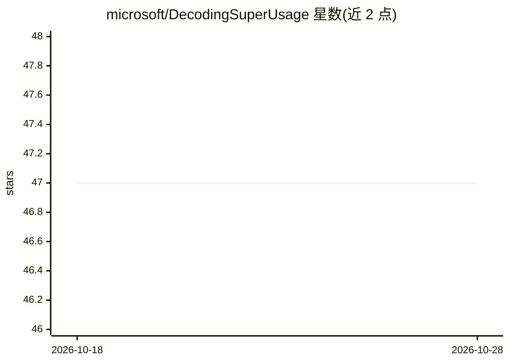

# microsoft/DecodingSuperUsage

⭐ 47 · MIT · 推送 2026-10-20 · [GitHub](https://github.com/microsoft/DecodingSuperUsage) · 组织维护

**分析 Microsoft 365 Copilot 超级用户行为模式的 Power BI 模板工具包**

微软维护的采用率分析工具包：通过 Viva Insights Person Query 导出 Copilot 使用与协作指标数据，加载到 Power BI 仪表盘（CSV 导入或 Direct Query 两种方式），展示超级用户的画像、成长路径、工作模式与部门分布，用于复制采用路径、确定赋能优先级。附带查询配置指南、解读指南与 PPT 故事板模板，支持行级安全（RLS）与自动刷新。需 Viva Insights 管理员先行配置查询。

## 筛选速览

| 维度 | 判定 | 备注 |
|---|---|---|
| AI 角色 | `ai-knowledge` | 知识聚合/清单类 |
| 许可风险 | `permissive` | MIT |
| 部署形态 | `None` |  |
| 模型依赖 | — | README 未给出锁定关系 |
| 硬件要求 | — | 无带数字的原话,不猜 |
| 安装摩擦 | `low` | 无编译、无系统依赖或容器化 |
| 成熟度 | — | 结构信号不足 |

## 能力要点

- 基于 Viva Insights Person Query 数据的 Power BI 仪表盘（CSV/Direct Query 双模式）
- 超级用户画像、成长旅程、工作模式与分布四类分析视角
- 行级安全（RLS）按组织/职能/个人控制数据可见性
- 附带解读指南（PDF）与高管汇报故事板模板（PPTX）

## 适用场景

- 我负责 Copilot 推广，想找出超级用户并复制他们的使用模式
- 按部门定位采用率洼地，规划赋能投入
- 向管理层汇报 Copilot 采用进展与早期行为信号

## 场景标签

 · 领域:企业协作分析/AI 采用度量

## 证据(README 行号)

> L10: ### Discover how Copilot super users emerge, surface use cases and scale their patterns across your organization.
> L36: Super usage patterns show how experimentation turns into durable habits. Identifying early signals and contextual a

## 星数曲线

2026-10-18 47 → 2026-10-28 47（+0）

---
*卡片 v1 · prompt 1.4 · 生成 2026-10-25 · 置信度 mid · 依据 README sha `f30007095b65` · [字段定义](../../DATASET.md)*
